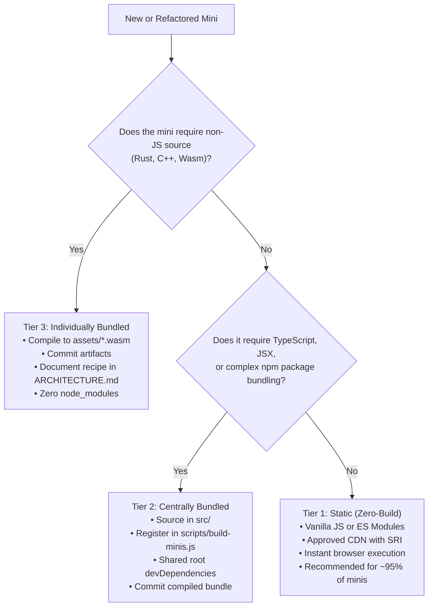

# Centralized Build and Bundling Strategy for Minis

This document defines the build, compilation, and bundling model for mini-projects in **Cradle** (`projects/<category>/<slug>/`). It establishes clear boundaries between static, centrally bundled, and individually bundled projects to eliminate fragmented tooling, rogue configuration files, and duplicated third-party dependencies.

---

## 1. Executive Summary & Core Principles

Cradle is home to 70+ standalone experiments, tools, and games. Historically, the repository operated on an absolute zero-build philosophy. As minis grow in sophistication—leveraging TypeScript, WebAssembly, Web Workers, and multi-file architectures—uncoordinated tooling poses significant risks:
- **Toolchain Fragmentation**: Disparate build tools (Vite, Webpack, Parcel, Rollup, esbuild) scattered across mini directories with conflicting version requirements.
- **Dependency Duplication**: Redundant, unpinned copies of common libraries (such as Chart.js, Three.js, Lucide, MathJS) vendored multiple times or committed into local `node_modules`.
- **Broken Discoverability & Local Serving**: Minis failing to run when opening `index.html` or serving static files because an undocumented build step was omitted.

### Core Architectural Invariants

1. **The Static Runtime Invariant**: Every mini MUST be runnable directly by serving static files over HTTP without running per-project package installations or per-project build commands. Cloned repositories and deployment environments must be instantly functional.
2. **No Per-Mini `node_modules`**: Mini directories MUST NEVER contain a local `node_modules/` folder or standalone `package.json` with independent package managers.
3. **Unified Root Tooling**: All compilation, bundling, and asset pipelines are orchestrated from the repository root via `scripts/build-minis.js` and root `package.json`.
4. **Deduplication by Default**: Common libraries and utilities must be shared via approved CDN scripts with Subresource Integrity (SRI), shared Cradle UI primitives, or root-managed build dependencies.

---

## 2. The 3-Tier Mini Build Model

Every mini in Cradle belongs to one of three standardized tiers:

```
┌────────────────────────────────────────────────────────┐
│                   Tier 1: Static                       │  Default (~95% of minis)
│            Zero-Build, Native Web Standards            │  No compiler, instant reload
└──────────────────────────┬─────────────────────────────┘
                           │ If TS/JSX/npm bundling needed
                           ▼
┌────────────────────────────────────────────────────────┐
│              Tier 2: Centrally Bundled                 │  Root-orchestrated tooling
│         Shared Root Tooling & Deduplicated Deps        │  Committed output bundle
└──────────────────────────┬─────────────────────────────┘
                           │ If foreign toolchain (Rust/Wasm, C)
                           ▼
┌────────────────────────────────────────────────────────┐
│             Tier 3: Individually Bundled               │  Specialized pipelines
│           Isolated Pre-Build & Committed Wasm          │  Zero node_modules, mock fallback
└────────────────────────────────────────────────────────┘
```

---

### Tier 1: Static (Zero-Build) — *Default & Strongly Preferred*

Tier 1 projects require no compilation, transpilation, or bundling step whatsoever. They represent the standard and ideal architecture for Cradle experiments.

- **Source Format**: Standard HTML5, CSS3, vanilla JavaScript (ES2020+), and native browser ES Modules (`<script type="module">`).
- **File Layout**:
  ```text
  projects/<category>/<slug>/
  ├── index.html       # Direct browser entrypoint
  ├── style.css        # Mini styling
  ├── script.js        # Main execution logic (or modular: app.js, engine.js)
  ├── thumbnail.svg    # Card preview
  └── ARCHITECTURE.md  # Mini documentation
  ```
- **Modular Code**: Allowed without bundlers via native browser `<script type="module">` (e.g. `pathfinding-visualizer` importing `algorithms.js` and `grid.js`).
- **External Dependencies**:
  - Must follow [`THIRD_PARTY_POLICY.md`](../THIRD_PARTY_POLICY.md).
  - Loaded exclusively from approved CDNs (`unpkg.com`, `cdn.jsdelivr.net`, `cdnjs.cloudflare.com`) with mandatory Subresource Integrity (`integrity="sha384-..."` / `crossorigin="anonymous"`).
  - Alternatively, single-file vendor scripts with clear license headers may be placed in `assets/`.
- **When Appropriate**:
  - Pure DOM applications, canvas simulations, standard Web Audio synths, standard WebGL shaders.
  - Multi-file projects that run natively using browser ES modules.
  - ~95% of all Cradle minis.

---

### Tier 2: Centrally Bundled — *Root-Managed Compilation*

When a mini legitimately requires language transpilation (TypeScript, JSX) or complex dependency tree-shaking from npm, it is built through the **central root build orchestrator** (`scripts/build-minis.js`).

- **Source Format**: TypeScript (`.ts`), JSX (`.jsx`), or modular JavaScript organized inside a `src/` subfolder within the mini.
- **File Layout**:
  ```text
  projects/<category>/<slug>/
  ├── src/             # Source files (TypeScript, JSX, modules)
  │   └── main.js      # Entrypoint declared in build registry
  ├── dist/            # (or root script.js) Committed compiled bundle
  │   └── bundle.js    # Built artifact
  ├── index.html       # Loads dist/bundle.js (or script.js)
  ├── style.css        # Styles
  ├── thumbnail.svg    # Card preview
  └── ARCHITECTURE.md  # Documents the centrally bundled architecture
  ```
- **Tooling & Configuration**:
  - **Toolchain lives at root**: The bundler (such as `esbuild`) and root `devDependencies` are declared in the root `package.json`.
  - **No per-mini bundler configs**: No `webpack.config.js`, `vite.config.ts`, `rollup.config.js`, or `tsconfig.json` inside mini directories.
  - **Central Registration**: The project registers its entrypoint, output path, and external dependencies in `scripts/build-minis.js` (under `CENTRAL_BUILD_REGISTRY`).
- **Committed Artifact Invariant**:
  - The compiled distribution bundle (`dist/bundle.js` or `script.js`) **must be committed to git**.
  - This ensures developers and CI can immediately run the project statically without running the build step.
- **Dependency Deduplication**:
  - If multiple centrally bundled minis use the same npm package (e.g., `chart.js`, `three`, `d3`), it is installed once at repository root.
  - Common vendor chunks can be externalized or shared to avoid bloating git history.
- **When Appropriate**:
  - Minis requiring strict TypeScript typing across dozens of complex algorithmic files.
  - Complex UI prototypes requiring JSX compilation.
  - Complex state management requiring tree-shaken external npm libraries.

---

### Tier 3: Individually Bundled (Isolated Pre-Build) — *Specialized Pipelines*

Tier 3 is reserved exclusively for projects with specialized or non-JavaScript compilation pipelines that cannot be standardized across the repo (e.g., Rust to WebAssembly via `wasm-pack`, C/C++ via Emscripten, or offline AI weight quantization).

- **Encapsulation & Security Rules**:
  1. **Strictly NO committed `node_modules`**: Any temporary build artifacts or package directories must be ignored via `.gitignore` and never committed.
  2. **Committed Binaries & Glue Code**: The pre-compiled `.wasm` binaries and corresponding JavaScript wrapper must be committed into `assets/` or `dist/`.
  3. **Zero-Setup Runtime**: A visitor downloading or cloning the repo must be able to open `index.html` and run the mini immediately without having Rust, LLVM, or Emscripten installed.
  4. **Reproducible Recipe in `ARCHITECTURE.md`**: The mini's architecture doc must contain a `## Build & Tooling` section detailing exact toolchain versions, build commands, and flags.
  5. **Graceful Degradation**: If WebAssembly fails to load or browser support is missing, the mini must display a user-friendly error or pure-JS fallback rather than crashing silently.
- **When Appropriate**:
  - High-performance physics simulations or audio DSP engines compiled from Rust/C++ into WebAssembly.
  - Custom offline dataset generators or model converters.

---

## 3. Decision Matrix & Selection Rubric

To determine the correct tier for any new or existing mini, follow this decision matrix:

| Criterion | Tier 1: Static (Zero-Build) | Tier 2: Centrally Bundled | Tier 3: Individually Bundled |
| :--- | :--- | :--- | :--- |
| **Primary Language** | Standard JavaScript (ES6+), HTML, CSS | TypeScript, JSX, Modern JS | Rust, C/C++, WebAssembly, Python |
| **Tooling Location** | None (browser native) | Repository Root (`scripts/`) | Dedicated pre-build recipe |
| **Per-Mini Config** | Forbidden | Forbidden (registered in root) | Local build script (e.g. `build.sh`) |
| **Output In Git** | Source is runtime code | Compiled bundle committed | Compiled Wasm/JS committed |
| **External Packages** | CDN with SRI or vendored asset | Root `devDependencies` | Toolchain dependencies (Wasm/Cargo) |
| **Maintenance Burden** | Very Low | Low | Medium |

### Decision Flowchart



---

## 4. Preventing Inconsistent Tooling & Anti-Patterns

To keep the repository clean and maintainable, the following anti-patterns are strictly prohibited:

### ❌ Anti-Pattern 1: Rogue Per-Mini Bundler Configurations
```text
# FORBIDDEN:
projects/games/my-game/vite.config.js
projects/games/my-game/webpack.config.js
projects/games/my-game/tsconfig.json
```
**Remedy**: Minis requiring bundling must register with the root orchestrator (`scripts/build-minis.js`) rather than introducing idiosyncratic build configs.

### ❌ Anti-Pattern 2: Per-Mini `package.json` and `node_modules`
```text
# FORBIDDEN:
projects/aiml/my-model/package.json
projects/aiml/my-model/node_modules/
```
**Remedy**: Add shared dependencies to the repository root's `package.json`. Per-mini package trees break dependency audits, duplicate versions, and create nested lockfiles.

### ❌ Anti-Pattern 3: Committing Unbuilt Source Without Artifacts
```text
# FORBIDDEN:
projects/misc/my-tool/index.html   <-- References "main.tsx"
projects/misc/my-tool/main.tsx     <-- Uncompiled TypeScript
```
**Remedy**: Browsers cannot execute raw `.ts` or `.jsx`. All projects must provide a runnable static entrypoint (`index.html` loading built `.js`).

---

## 5. Preventing Duplicated Dependencies

Dependency sprawl is a primary source of repository bloat and security risk. Cradle enforces the following resolution hierarchy:

```
1. Native Browser APIs (Web Audio, Canvas 2D, WebGL, IndexedDB, Workers)
   ▼
2. Shared Cradle UI & Utilities (src/components/ui/ — Button, Card, Storage, Sanitize)
   ▼
3. Shared Approved CDNs with SRI (cdnjs, unpkg, jsdelivr with SHA hashes)
   ▼
4. Centralized Root Dependencies (shared across Centrally Bundled minis)
   ▼
5. Vendored Assets (isolated single-file libraries in assets/)
```

### Shared Third-Party Libraries

When multiple minis need identical capabilities, authors must not vendor divergent versions. The repository standardizes on approved libraries:

| Capability | Approved Solution | Delivery Method |
| :--- | :--- | :--- |
| **UI Components & Themes** | Cradle UI (`src/components/ui/`) | Monorepo source / barrel export |
| **Safe Storage** | `CradleStorage` (`storage.js`) | Monorepo utility |
| **HTML/SVG Sanitization** | `CradleSanitize` (`sanitizeHtml.js`, `sanitizeSvg.js`) | Monorepo utility |
| **Charts & Graphs** | `Chart.js` | Approved CDN with SRI |
| **Diagrams & Flowcharts** | `DiagramToolkit` / `Mermaid.js` | Monorepo utility / CDN with SRI |
| **Math & Algorithms** | Native ES6 modules or `mathjs` | CDN with SRI or root devDep |

Duplicate JavaScript implementations across projects are automatically flagged by `npm run detect:duplicates`.

---

## 6. Centralized Build Orchestrator (`scripts/build-minis.js`)

Cradle provides a centralized build runner at `scripts/build-minis.js`.

### Commands

```bash
# Check all minis against the Build Strategy rules (CI gate)
npm run validate:build-strategy
# or
node scripts/build-minis.js --check

# List all projects categorized by build tier
node scripts/build-minis.js --list

# Execute the centralized build pipeline for all Tier 2 projects
npm run build:minis
# or
node scripts/build-minis.js --build
```

### Registry Specification

Centrally bundled and individually bundled minis are registered in `scripts/build-minis.js`:

```javascript
const BUILD_REGISTRY = {
  // Tier 2: Centrally Bundled projects
  central: [
    {
      slug: "projects/category/project-name/",
      entry: "src/main.js",
      output: "dist/bundle.js",
      format: "iife", // iife | esm
    }
  ],
  // Tier 3: Individually Bundled (pre-built specialized artifacts)
  individual: [
    {
      slug: "projects/category/wasm-project/",
      artifacts: ["assets/engine.wasm", "assets/engine.js"],
      docSection: "## Build & Tooling",
    }
  ]
};
```

---

## 7. Contributor Workflow

1. **Start with Tier 1 (Static)**: Author your mini with standard HTML, CSS, and JS. Use browser ES modules (`type="module"`) if splitting into multiple files.
2. **Need an External Library?**: Check `THIRD_PARTY_POLICY.md`. Find an approved CDN (e.g. cdnjs) and compute its Subresource Integrity (SRI) hash.
3. **Need TypeScript or JSX?**:
   - Do NOT add a local `package.json` or `vite.config.js`.
   - Place source code in `src/`.
   - Register the entrypoint in `scripts/build-minis.js`.
   - Compile the bundle via `npm run build:minis` and commit the resulting artifact.
4. **Need WebAssembly (Rust/C++)?**:
   - Compile locally into `assets/<name>.wasm`.
   - Commit the generated `.wasm` and `.js` wrapper.
   - Document the exact compilation recipe in `ARCHITECTURE.md`.
5. **Verify Before Submitting**:
   ```bash
   node scripts/build-minis.js --check
   npm run validate:mini-contract
   ```

