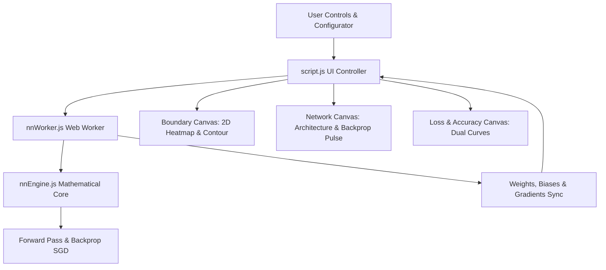

# Neural Network Playground Architecture Documentation

## Overview

The Neural Network Playground is an interactive visual deep learning simulation environment built with Vanilla HTML5 Canvas, ES6 Modular JavaScript, and Web Workers. It empowers users to dynamically construct custom Multi-Layer Perceptron (MLP) architectures with 1 to 6 hidden layers and variable neuron counts, select activation functions (ReLU, Sigmoid, Tanh, LeakyReLU), configure hyperparameters (learning rate, batch size, L2 regularization), and observe real-time backpropagation training over a continuous 2D classification decision boundary contour heatmap alongside synchronized dual-axis loss and accuracy curves.

The project demonstrates neural network fundamentals—non-linear decision surface formation, vanishing gradient dynamics, and overfitting/underfitting behaviors—entirely client-side without external machine learning frameworks.

## Purpose & Goals

- Provide an interactive visual laboratory for understanding Multi-Layer Perceptron (MLP) mechanics and backpropagation training.
- Enable dynamic creation and deletion of hidden layers with granular per-layer neuron controls and educational architecture presets.
- Demonstrate the non-linear transformation capabilities of different activation functions (ReLU, Sigmoid, Tanh, LeakyReLU).
- Render a live 2D decision boundary contour heatmap with decision isolines ($p = 0.5$) to demystify classification frontiers.
- Provide synchronized real-time loss and accuracy curves on a dual-axis canvas to visualize convergence, plateauing, and divergence.
- Illustrate vanishing gradients in deep networks and overfitting/underfitting dynamics with L2 regularization controls.

## Folder Structure

```text
projects/aiml/neural-network-playground/
├── ARCHITECTURE.md    # Standardized architecture documentation
├── index.html         # Workspace layout, control panels, and visualization canvases
├── nnEngine.js        # Core matrix math, activation functions, forward pass, and backpropagation
├── nnWorker.js        # Web Worker for non-blocking background training
├── script.js          # Canvas rendering loops, UI controls, and event wiring
├── style.css          # Dark-mode styling, preset buttons, and responsive design tokens
└── thumbnail.svg      # Project preview thumbnail
```

## System / Project Architecture Overview

The system decouples mathematical computation from rendering using a Web Worker with a graceful main-thread fallback:



## Layer Topology Configuration

- **Input Layer**: 2 features $(x_1, x_2)$ representing normalized 2D coordinate points in range $[-1, 1]$.
- **Hidden Layers**: Dynamic array of hidden layers, customizable from 1 to 6 layers, each with 1 to 16 hidden units. Includes one-click presets: Default `[6, 4]`, Shallow `[2]`, Deep `[4, 4, 4, 4]`, Pyramid `[10, 6, 3]`, and Wide `[12, 8]`.
- **Output Layer**: 1 output unit representing binary classification probability $p \in [0, 1]$ via Sigmoid activation.
- **Trainable Parameters**:
  $$\text{Params} = \sum_{l=0}^{L-1} \left( n_l \times n_{l+1} + n_{l+1} \right)$$

## Mathematical Formulations

1. **Activation Functions**:
   - `ReLU`: $f(x) = \max(0, x)$, $f'(x) = 1 \text{ if } x > 0 \text{ else } 0$
   - `Sigmoid`: $f(x) = \frac{1}{1 + e^{-x}}$, $f'(x) = f(x)(1 - f(x))$
   - `Tanh`: $f(x) = \tanh(x)$, $f'(x) = 1 - \tanh^2(x)$
   - `LeakyReLU`: $f(x) = x \text{ if } x > 0 \text{ else } 0.01x$, $f'(x) = 1 \text{ if } x > 0 \text{ else } 0.01$

2. **Loss Function**:
   Binary Cross-Entropy Loss:
   $$\mathcal{L} = -\frac{1}{N} \sum_{i=1}^N \left[ y_i \log(\hat{y}_i) + (1 - y_i) \log(1 - \hat{y}_i) \right]$$

3. **Weight Updates with L2 Regularization**:
   $$W_{l,j,k} \leftarrow W_{l,j,k} - \eta \left( \frac{\partial \mathcal{L}}{\partial W_{l,j,k}} + \lambda W_{l,j,k} \right)$$
   $$b_{l,j} \leftarrow b_{l,j} - \eta \frac{\partial \mathcal{L}}{\partial b_{l,j}}$$

## Component Breakdown

| File          | Responsibility                                                                                                                                     |
| ------------- | -------------------------------------------------------------------------------------------------------------------------------------------------- |
| `index.html`  | UI dashboard, preset selectors, layer configurator, hyperparameter controls, diagnostics banner, and the three visualization canvases.              |
| `script.js`   | State coordinator, canvas rendering engines (decision boundary heatmap, network topology graph, dual-curve loss/acc chart), and event listeners.  |
| `nnEngine.js` | Core mathematical operations: He initialization, forward pass, SGD backpropagation, gradient norm tracking, and L2 regularization.               |
| `nnWorker.js` | Web Worker running compute-intensive mini-batch SGD and grid prediction off the main thread with state synchronization.                           |
| `style.css`   | Dark-mode design system, interactive controls, layer buttons, legend indicators, and responsive layouts.                                          |

## Data Flow / Execution Flow

1. **Architecture & Dataset Configuration**: The user selects or imports a 2D classification dataset (Circle, XOR, Spiral, Gaussian, Moons, or custom CSV) and configures the hidden layers and activation functions.
2. **Network Initialization**: `nnEngine.js` performs He normal initialization scaled by $\sqrt{2 / \text{fanIn}}$. The model weights and biases are synchronized to `nnWorker.js`.
3. **Training Execution Loop**:
   - `trainStep()` requests training iterations from `nnWorker.js` (or executes on the main thread if Web Workers are unavailable).
   - In each epoch, inputs are shuffled into mini-batches. Forward passes compute activations; backpropagation propagates errors backwards calculating $\delta_l$ and layer gradient norms.
   - Weights and biases are updated using learning rate $\eta$ and optional L2 weight decay $\lambda$.
4. **Visual Rendering Updates**:
   - **Decision Boundary Heatmap**: Evaluates network predictions over a 2D grid, rendering an interpolated color gradient (Class 0 in blue, Class 1 in crimson) with a white decision boundary contour isoline ($p = 0.5$).
   - **Network Graph & Backprop Pulse**: Draws layer columns and synaptic connection weights scaled by magnitude, with dynamic pulses visualizing backpropagation error flow.
   - **Real-Time Curves**: Concurrently plots the training loss curve (amber) and accuracy curve (emerald) with dual Y-axis scales.
   - **Diagnostics**: Monitors early-layer gradient norms to detect vanishing gradients, and flags potential overfitting or underfitting based on dataset noise and parameter capacity.

## Key Features

- **Custom MLP Architecture Builder**: Dynamically add and remove hidden layers (1 to 6 layers), adjust per-layer neuron counts (1 to 16 neurons), or select educational presets (Default, Shallow, Deep, Pyramid, Wide).
- **Selectable Activation Functions**: Toggle between ReLU, Sigmoid, Tanh, and LeakyReLU with live mathematical derivatives.
- **Hyperparameter Tuning Suite**: Fine-tune learning rates (0.0001 to 1.0), mini-batch sizes (Full batch, 8, 16, 32, 64), and L2 regularization weight decay (0 to 0.01).
- **2D Classification Decision Boundary Heatmap**: Interactive continuous heatmap showing non-linear separation contours, highlighted decision isolines ($p = 0.5$), and misclassified point warnings.
- **Real-Time Dual Loss & Accuracy Curves**: Synchronized dual-axis chart plotting both Binary Cross-Entropy loss and classification accuracy over epochs.
- **Vanishing Gradient & Capacity Diagnostics**: Live diagnostic telemetry detecting vanishing gradients in deep Sigmoid architectures and warning against overfitting on noisy datasets.
- **Multi-Format Model Export**: Export trained neural network weights and forward-pass inference code as standalone JavaScript or Python scripts.

## Technologies Used

| Technology                | Purpose                                                  |
| ------------------------- | -------------------------------------------------------- |
| HTML5 & Semantic Elements | Workspace structure, control panels, and Canvas elements |
| CSS3 (Flexbox & Grid)     | Responsive dark-mode layout and interactive controls     |
| Vanilla JavaScript (ES6+) | Mathematical neural network algorithms and DOM wiring    |
| HTML5 Canvas 2D API       | High-frequency heatmap, network graph, and chart drawing |
| Web Workers API           | Non-blocking background training execution               |

## File Responsibilities

### `index.html`

- Declares control panels for training, dataset generation, MLP architecture, hyperparameters, and model export.
- Houses canvases for the decision boundary heatmap (`boundaryCanvas`), network architecture (`networkCanvas`), and training curves (`lossCanvas`).
- Provides educational diagnostic telemetry boxes and accessible ARIA attributes.

### `script.js`

- Manages application state, canvas rendering routines, and training loop orchestration.
- Renders the decision boundary contour heatmap, network graph with backprop pulses, and dual-axis loss/accuracy chart.
- Handles Web Worker lifecycle, message dispatching, and main-thread fallback execution.

### `nnEngine.js`

- Implements activation functions and their mathematical derivatives.
- Provides dataset generation and coordinate normalization.
- Implements `NeuralNetwork` class: He weight initialization, forward propagation, and mini-batch backpropagation with L2 regularization.

### `nnWorker.js`

- Offloads training epochs and grid predictions from the UI thread.
- Communicates loss, accuracy, synchronized weights, and layer gradient norms back to the main thread.

### `style.css`

- Defines color variables, typography, layout cards, preset buttons, and responsive breakpoints.

### `thumbnail.svg`

- Vector preview artwork used in the project registry.

## Design Decisions

- **Isolated Mathematical Engine**: Mathematical operations and network modeling are isolated in `nnEngine.js` with UMD exports, enabling headless unit testing via Node.js while keeping UI code in `script.js`.
- **Web Worker Offloading with Main-Thread Fallback**: High-speed SGD iterations run off-thread to maintain smooth UI frame rates (60 FPS), with automatic fallback to cooperative main-thread execution if Web Workers are blocked.
- **Dual-Axis Loss and Accuracy Curves**: Plotting both loss and accuracy on a unified timeline provides immediate visual feedback on learning dynamics, plateauing, and convergence.
- **Decision Boundary Isoline Highlighting**: Explicitly tracing points near $p = 0.5$ emphasizes the geometric frontier separating classes in 2D space.
- **Layer-Specific Gradient Tracking**: Monitoring average gradient norms across layers makes the vanishing gradient problem in deep Sigmoid networks tangible and observable.

## Dependencies

| Dependency    | Version | How loaded       | Purpose                            |
| ------------- | ------- | ---------------- | ---------------------------------- |
| Outfit / Inter| Latest  | Google Fonts CDN | Application typography             |
| Font Awesome  | 6.5.0   | cdnjs CDN        | Control panel and dashboard icons  |

No machine learning frameworks (e.g. TensorFlow.js, PyTorch) or external visualization libraries are used; the neural network and rendering engines are implemented from scratch.

## Future Improvements

- Add support for multiclass classification with softmax output and 3+ colors.
- Introduce momentum and Adam optimizers alongside vanilla SGD.
- Provide interactive point addition via mouse click directly on the decision boundary canvas.

## Known Limitations

- Running training at maximum speed (100 steps/frame) on older hardware in compatibility mode (no Web Workers) may cause minor frame drops.
- Grid prediction resolution on the decision boundary canvas is capped at 3px to maintain real-time responsiveness during training.

## Development Notes

- Serve the directory using a local HTTP server (`npm run dev`) so Web Workers can load without cross-origin file protocol restrictions.
- Run repository integrity scripts (`node scripts/validate-no-dynamic-eval.js`, `node scripts/validate-accessible-labels.js`, `node scripts/validate-worker-integrity.js`, `node scripts/validate-architecture-docs.js`) after modifying code or architecture files.

## License & Attribution

- **Project License:** MIT, inherited from the Cradle repository.
- **Third-Party Assets:**
  - Inter & JetBrains Mono fonts via Google Fonts CDN.
  - Font Awesome 6.5.0 icons via cdnjs CDN.

## References

- [Backpropagation — Wikipedia](https://en.wikipedia.org/wiki/Backpropagation)
- [Stochastic Gradient Descent — Wikipedia](https://en.wikipedia.org/wiki/Stochastic_gradient_descent)
- [He et al. Delving Deep into Rectifiers: Surpassing Human-Level Performance on ImageNet Classification](https://arxiv.org/abs/1502.01852)
- [MDN Web Docs — Canvas API](https://developer.mozilla.org/en-US/docs/Web/API/Canvas_API)
- [Cradle contribution guide](../../../CONTRIBUTING.md)
