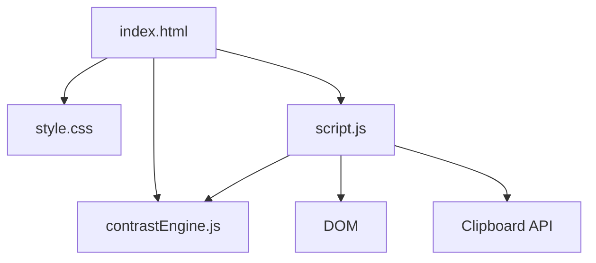

# Color Contrast Checker Architecture

## Overview

Color Contrast Checker is a client-side accessibility utility for comparing foreground and background color pairs. It calculates WCAG 2.1 contrast ratios and modern W3C WCAG 3.0 APCA (Advanced Perceptual Contrast Algorithm) lightness contrast ($L_c$ values) in the browser, provides real-time SVG filter simulation of Color Vision Deficiencies (Protanopia, Deuteranopia, Tritanopia, and Achromatopsia) across live typography and button components, reports AA and AAA pass/fail states, and helps users copy accessible CSS variables without a backend or build step.

---

## Purpose & Goals

- Provide a quick browser tool for validating color contrast against both WCAG 2.1 thresholds and WCAG 3.0 APCA readability standards.
- Keep the WCAG and APCA math in pure JavaScript functions that can be tested with Node.js.
- Simulate Color Vision Deficiencies in real time using native SVG color matrices on interactive typography and button preview components.
- Offer practical next steps through accessible color suggestions and CSS variable output.
- Match the repository's lightweight mini-project pattern with plain HTML, CSS, and JavaScript.

---

## Folder Structure

```text
color-contrast-checker/
├── index.html          # Semantic UI shell and form controls
├── style.css           # Responsive dark-theme styling
├── script.js           # DOM events, rendering, clipboard, and palette interactions
├── contrastEngine.js   # Pure WCAG contrast logic and exports for tests
├── ARCHITECTURE.md     # Project architecture documentation
└── thumbnail.svg       # Generated project thumbnail
```

---

## System / Project Architecture Overview

The project separates testable contrast logic from browser-only UI code. `index.html` loads `contrastEngine.js` first, exposing pure functions through the `ContrastEngine` object, then loads `script.js`, which reads user inputs, calls the engine, and renders the results.



---

## Component Breakdown

| File                | Responsibility                                                                                                                                                                                                         |
| ------------------- | ---------------------------------------------------------------------------------------------------------------------------------------------------------------------------------------------------------------------- |
| `index.html`        | Provides color inputs, dual meters (WCAG 2.1 & APCA), CVD filter tabs, live typography & button preview, SVG filter definitions, status cards, APCA grid, CVD comparison matrix, and suggestions.                    |
| `style.css`         | Defines the dark dev-tools layout, dual meter cluster, CVD pill tabs, live typography & button component styles, status cards, suggestions, CVD matrix cards, and responsive rules.                                   |
| `script.js`         | Connects DOM events to the engine, syncs color picker/hex values, toggles SVG CVD filters, updates dual meters and live typography/button previews, renders WCAG/APCA/CVD cards, and copies CSS variables.           |
| `contrastEngine.js` | Pure helpers: hex normalization, relative luminance, WCAG 2.1 ratio calculation, W3C WCAG 3.0 APCA lightness contrast calculation ($L_c$), APCA tier evaluation, CVD matrix simulations, and accessible suggestions. |

---

## Data Flow / Execution Flow

```text
User opens index.html
↓
Browser loads style.css, contrastEngine.js, then script.js
↓
script.js renders local sample palettes and reads the default colors
↓
ContrastEngine validates hex values, calculates WCAG 2.1 ratio, APCA Lc score, and CVD simulations
↓
script.js updates dual meters (WCAG ratio + APCA Lc), typography/button preview, WCAG & APCA status cards, and CVD matrix
↓
User switches CVD tabs (Normal, Protanopia, Deuteranopia, Tritanopia, Achromatopsia)
↓
Active SVG filter is overlaid onto the live typography and button preview in real time
↓
User changes colors, applies a palette, picks a suggestion, or copies CSS
↓
The relevant event handler reruns the report and updates the DOM
```

---

## Key Features

- **Dual Accessibility Meters**: Side-by-side display of WCAG 2.1 Contrast Ratio and WCAG 3.0 APCA Lightness Contrast ($L_c$) with polarity indicators (`Dark on Light` / `Light on Dark`).
- **W3C WCAG 3.0 APCA Engine**: Evaluates perceptual readability according to spatial frequency and lightness perception ($L_c\ 90$ Fluent, $L_c\ 75$ Body, $L_c\ 60$ Large Content, $L_c\ 45$ Headlines, $L_c\ 30$ Non-Text).
- **Color Vision Deficiency (CVD) Simulation**: Real-time native SVG `<feColorMatrix>` filter simulation for:
  - **Protanopia** (Red-blind / L-cone deficiency)
  - **Deuteranopia** (Green-blind / M-cone deficiency)
  - **Tritanopia** (Blue-blind / S-cone deficiency)
  - **Achromatopsia** (Complete color blindness / monochromacy)
- **Live Typography & Component Preview**: Overlaid typography (32px Headline, 20px Subheading, 16px Body Copy, 13px Caption) and interactive UI buttons (Solid CTA, Outline Button, Status Pill).
- **CVD Simulation Matrix**: Side-by-side cards comparing simulated foreground/background appearance, simulated WCAG ratios, and simulated APCA scores for all 4 deficiencies.
- **WCAG 2.1 Compliance Cards**: AA and AAA pass/fail cards for normal text, large text, and UI components.
- **Accessible Color Suggestions**: Suggests lighter or darker accessible foreground alternatives when current pair fails AA normal text.
- **CSS Variable Generation**: 1-click clipboard copy of accessible `--contrast-foreground` and `--contrast-background` variables.
- **Sample Palettes**: Curated local palettes for instant accessibility benchmarking.

---

## Technologies Used

| Technology          | Purpose                                                                      |
| ------------------- | ---------------------------------------------------------------------------- |
| HTML5               | Semantic structure for the tool UI.                                          |
| CSS3                | Grid, responsive layout, custom properties, and dark dev-tools styling.      |
| Vanilla JavaScript  | WCAG calculations, DOM updates, palette interactions, and clipboard support. |
| Clipboard API       | Copies generated CSS variables from the browser.                             |
| Node.js `node:test` | Unit tests for contrast math, hex validation, and pass/fail logic.           |

---

## File Responsibilities

### `index.html`

- Defines the foreground and background input controls.
- Provides the live typography and button component preview, dual meters (WCAG 2.1 & APCA), and CVD simulation tabs.
- Houses SVG filter definitions for Protanopia, Deuteranopia, Tritanopia, and Achromatopsia.
- Contains empty result containers that `script.js` fills on load (WCAG status grid, APCA grid, CVD comparison matrix, and suggestions).
- Loads `contrastEngine.js` before `script.js` so UI code can call the engine.

### `contrastEngine.js`

- `normalizeHex(input)` accepts supported hex formats and returns normalized lowercase `#rrggbb` values.
- `isValidHexColor(input)` returns whether a value can be normalized.
- `hexToRgb(input)` converts normalized colors into RGB channel values.
- `getRelativeLuminance(input)` implements WCAG relative luminance.
- `calculateContrastRatio(foreground, background)` returns a rounded WCAG 2.1 contrast ratio.
- `getWcagStatus(ratio)` maps the ratio to AA/AAA pass/fail booleans.
- `calculateApca(foreground, background)` computes the WCAG 3.0 APCA lightness contrast ($L_c$) score with polarity.
- `getApcaStatus(lc)` maps the $L_c$ score to readability tiers (Fluent, Body, Large Content, Headlines, Non-text).
- `simulateCvd(hexColor, cvdType)` transforms an sRGB hex color into simulated color vision deficiency perception.
- `getCvdSimulationReport(foreground, background)` produces simulated colors, WCAG ratios, and APCA scores for all 5 vision conditions.
- `suggestAccessibleAlternatives(foreground, background)` finds lighter and darker foreground candidates.
- `getCssVariables(foreground, background)` creates a reusable CSS variable block.
- `getContrastReport(foreground, background)` returns the full validation, ratio, APCA, CVD, status, suggestions, and CSS payload.

### `script.js`

- Syncs text fields and color picker values.
- Renders dual meters for WCAG 2.1 ratio and WCAG 3.0 APCA lightness contrast ($L_c$).
- Manages active CVD filter state and applies SVG filters to the live preview.
- Updates live typography (32px headline, 20px subheading, 16px body, 13px caption) and button components (solid CTA, outline button, pill badge).
- Renders WCAG 2.1 status cards and WCAG 3.0 APCA criteria cards.
- Renders the interactive Color Vision Deficiency (CVD) comparison matrix.
- Applies local sample palettes and accessible foreground suggestions.
- Copies CSS variables with the Clipboard API.

### `style.css`

- Defines the page shell, input controls, dual meter cluster, CVD pill tabs, and live typography/button previews.
- Styles the status grid, APCA grid, suggestions, CVD matrix cards, and palette list.
- Uses responsive breakpoints so the workspace and meters stack cleanly on smaller screens.
- Uses accessible pass/fail/warning color treatments that remain readable on dark backgrounds.

---

## Design Decisions

- **Pure engine module** — WCAG calculations live in `contrastEngine.js` without DOM references, which keeps the important accessibility logic easy to test.
- **Script tag compatible export** — the engine attaches to `ContrastEngine` in the browser and exports through `module.exports` in Node.js, avoiding a bundler.
- **Foreground-first suggestions** — suggested alternatives modify the foreground color because that is usually the safest token to adjust while preserving a chosen background surface.
- **Local palettes only** — sample palettes are embedded in the engine to avoid network requests and keep the tool fully offline.
- **No framework** — the project follows the repository's mini-project convention of plain browser files.

---

## Dependencies

None. The project uses native browser APIs and Node.js built-ins only.

---

## Future Improvements

- Let users lock either foreground or background before generating suggestions.
- Export all sample palettes as CSS custom properties.
- Add a small history of recently tested color pairs.
- Add downloadable PNG/SVG swatch card export.

---

## Known Limitations

- Suggestions adjust only the foreground color.
- The checker evaluates solid hex colors and does not account for alpha transparency over complex image backgrounds.

---

## Development Notes

- Open the project through a local server from the repository root for the closest browser behavior:
  ```bash
  python3 -m http.server 8000
  ```
- Run the focused unit tests with:
  ```bash
  node --test tests/color-contrast-checker.test.js
  ```
- Regenerate the project registry and thumbnail with:
  ```bash
  npm run build
  ```

---

## License & Attribution

- **Project License:** MIT, following the repository license.
- **Third-Party Assets:** None. The UI, logic, documentation, and generated thumbnail are repository-native.

---

## References

- [Web Content Accessibility Guidelines 2.2](https://www.w3.org/TR/WCAG22/)
- [WCAG 3.0 Candidate Advanced Perceptual Contrast Algorithm (APCA)](https://www.w3.org/WAI/GL/task-forces/silver/wiki/Visual_Contrast_of_Text_Subgroup)
- [APCA Contrast Calculator & Documentation](https://www.apcacontrast.com/)
- [WCAG Understanding Success Criterion 1.4.3 Contrast Minimum](https://www.w3.org/WAI/WCAG22/Understanding/contrast-minimum.html)
- [WCAG Understanding Success Criterion 1.4.11 Non-text Contrast](https://www.w3.org/WAI/WCAG22/Understanding/non-text-contrast.html)
- [Brettel, Viénot, & Mollon: Color Vision Deficiency Simulation](https://www.inf.ufrgs.br/~oliveira/pubs_files/CVD_Simulation/CVD_Simulation.html)
- [MDN Web Docs: Relative luminance](https://developer.mozilla.org/en-US/docs/Web/Accessibility/Guides/Colors_and_Luminance)
