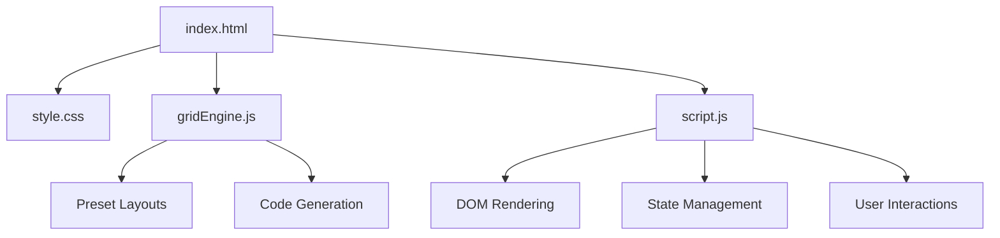

# CSS Grid Generator

> A visual tool for designing CSS Grid layouts with live preview and code export.

---

## Overview

CSS Grid Generator lets users design CSS Grid layouts visually in the browser. Users configure columns, rows, gap sizes, and item placements, then see a live preview and export production-ready HTML/CSS code. It includes several built-in layout presets (Holy Grail, Sidebar, Dashboard, etc.), an interactive drag-to-merge cell canvas for visual `grid-template-areas` definition, explicit named grid lines ([main-start] ... [main-end]), and real-time responsive breakpoint preview toggles (desktop, tablet, mobile) with production-ready media query generation.

---

## Purpose & Goals

- Provide an intuitive visual interface for designing CSS Grid layouts
- Enable frictionless visual drag-to-merge cell interactions for defining 2D `grid-template-areas`
- Support explicit named grid lines for semantic, clean CSS grid templates
- Provide instant responsive preview testing across mobile (375px), tablet (768px), and desktop (100%) viewports
- Generate clean, production-ready, readable HTML and CSS code with optional responsive media queries
- Include common layout presets for quick prototyping
- Keep the codebase vanilla HTML/CSS/JS with no build step

---

## Folder Structure

```text
css-grid-generator/
├── index.html      # Entry point and UI shell
├── style.css       # All visual styling
├── gridEngine.js   # Pure grid logic, code generation, presets
├── script.js       # UI controller, event handling, rendering
└── ARCHITECTURE.md # This file
```

---

## System / Project Architecture Overview

The project follows a clean separation of concerns:

- `index.html` defines the page structure with two-column layout (controls + preview)
- `gridEngine.js` is a pure logic module (no DOM dependency) that generates CSS/HTML code
- `script.js` manages DOM interactions, state, and live preview rendering
- `style.css` handles all visual presentation with CSS custom properties



---

## Component Breakdown

| File            | Responsibility                                                                      |
| --------------- | ----------------------------------------------------------------------------------- |
| `index.html`    | Page shell with two-column layout, all UI controls and preview area                 |
| `style.css`     | Dark/light theme, grid preview styling, responsive layout, code output styling      |
| `gridEngine.js` | Pure logic: presets, CSS generation, HTML generation, template area building        |
| `script.js`     | UI controller: state management, event wiring, live preview rendering, copy actions |

---

## Data Flow / Execution Flow

```text
User opens index.html
↓
Browser loads style.css, gridEngine.js, script.js
↓
DOMContentLoaded fires → script.js initializes
↓
Default state: 3×3 grid, 0 items
↓
User configures grid (columns, rows, gaps, sizing)
↓
Or clicks a preset → loads pre-configured state
↓
render() is called → builds grid preview and code output
↓
User adds items, selects items, configures placement
↓
Live preview updates in real-time
↓
Code tab shows generated CSS/HTML
↓
User clicks Copy → clipboard API copies code
```

---

## Key Features

- **Interactive Drag-to-Merge Cell Canvas** — Click and drag across rectangular grid cells to merge them visually into named `grid-template-areas` with live preview and automatic naming.
- **Explicit Named Grid Lines** — Assign bracketed line names (e.g. `[main-start] 1fr [main-end]`, `[header-start] auto [header-end]`) to column and row tracks, with auto-infer generation from area boundaries.
- **Responsive Breakpoint Viewport Toggles** — Instant real-time preview switches between Desktop (100%), Tablet (768px), and Mobile (375px) with device frames.
- **Responsive Media Query Generation** — Automatically outputs `@media (max-width: 768px)` CSS rules for mobile single-column stacking and adaptive area layouts.
- **Interactive Grid Configuration** — Steppers and inputs for columns, rows, custom sizing (`fr`, `px`, `repeat()`), and row/column gaps.
- **Visual Grid Item Placement** — Click-to-select items with color pickers, area names, and coordinate controls.
- **Named Grid Areas Support** — Auto-builds 2D `grid-template-areas` matrix (`"header header" "sidebar main" "footer footer"`).
- **6 Built-in Layout Presets** — Holy Grail, Sidebar, Cards, Dashboard, Gallery, and Blog layouts with pre-configured named areas and lines.
- **Live Preview & Visual Line Markers** — Numbered and named grid line indicators along column and row edges.
- **Code Export with Highlighting** — Export CSS-only, HTML-only, or combined code with one-click clipboard copying.
- **Dark/Light Theme** — Seamless theme styling with CSS custom properties.

---

## Technologies Used

| Technology                              | Purpose                                      |
| --------------------------------------- | -------------------------------------------- |
| HTML5                                   | Page structure and semantic markup           |
| CSS3 (Grid, Flexbox, Custom Properties) | Layout, theming, responsive design           |
| Vanilla JavaScript (ES6+)               | UI logic, state management, DOM manipulation |
| CradleEscape                            | Shared HTML escaping utility                 |
| CradleBackToHome                        | Shared navigation component                  |
| Google Fonts (Space Grotesk, Fira Code) | Typography                                   |

---

## File Responsibilities

### `gridEngine.js`

- `GridEngine.PRESETS` — Map of 6 named preset layouts with full configurations
- `GridEngine.ITEM_COLORS` — Palette of 12 colors cycled for new items
- `GridEngine.resolveColumnTemplate(count, sizeStr)` — Converts count + sizing string to CSS grid-template-columns
- `GridEngine.resolveRowTemplate(count, sizeStr)` — Converts count + sizing string to CSS grid-template-rows
- `GridEngine.splitTracks(template, count)` — Splits tracks taking `repeat()` into account
- `GridEngine.formatLineName(names)` — Sanitizes and formats CSS line names with brackets `[name]`
- `GridEngine.resolveColumnTemplateWithNames(count, sizeStr, namedLines)` — Interleaves column track sizing with explicit line names
- `GridEngine.resolveRowTemplateWithNames(count, sizeStr, namedLines)` — Interleaves row track sizing with explicit line names
- `GridEngine.inferNamedLinesFromAreas(cols, rows, items)` — Automatically generates conventional line names from area boundaries
- `GridEngine.mergeCellsToItem(r1, c1, r2, c2, areaName, color)` — Normalizes drag coordinates into standard item geometry
- `GridEngine.buildTemplateAreas(cols, rows, items)` — Generates 2D `grid-template-areas` matrix string
- `GridEngine.generateCSS(config, items)` — Produces complete CSS code with named lines, areas, and responsive media queries
- `GridEngine.generateHTML(items, useAreas)` — Produces clean HTML markup string
- `GridEngine.generateCode(tab, config, items)` — Returns CSS, HTML, or both based on selected tab

### `script.js`

- `getConfig()` — Reads current UI state, named lines, and responsive preferences
- `render()` — Full re-render: renders interactive cell slots, positioned items, line markers, and code output
- `initDragToMerge()` — Pointer capture events (`pointerdown`, `pointermove`, `pointerup`) for drag-to-merge cell selection
- `setBreakpoint(bp)` — Switches preview container viewport dimensions (`desktop`, `tablet`, `mobile`) and adapts layout preview
- `renderNamedLinesManager(config)` — Populates and synchronizes column and row line name inputs
- `renderLineMarkers(config)` — Positions top and left grid line markers with optional explicit line names
- `highlightCode()` — Applies syntax highlighting to CSS and HTML output
- `selectItem(idx)` / `deselectItem()` — Manages item selection and displays item configuration card
- `addItem()` / `removeItem()` / `resetGrid()` — Item and grid lifecycle management
- `loadPreset(name)` — Loads a preset layout configuration with inferred line names

### `style.css`

- CSS custom properties for dark and light themes
- Interactive drag-to-merge cell canvas styling with `.grid-cell-slot` and `.cell-drag-selected` highlights
- Responsive breakpoint preview viewport frames (`.viewport-tablet`, `.viewport-mobile`)
- Named lines manager card, line rows, and explicit line badges (`.has-named-line`)
- Two-column workspace layout with responsive collapse
- Code output panel with monospace typography and syntax token coloring

---

## Design Decisions

- **Visual Drag-to-Merge Interaction** — Instead of requiring users to manually type 1-based start and end row/column indices into inputs, the visual drag-to-merge canvas lets users select any 2D region directly. The bounding rectangle is normalized and instantly converted into a named area.
- **Explicit Named Lines Support** — Follows W3C CSS Grid Level 1 specification for bracketed line names (`[line-start] track [line-end]`), with auto-inference from area bounds for maximum productivity.
- **Embedded Viewport Breakpoint Testing** — Provides real-time preview switches (Desktop, Tablet 768px, Mobile 375px) without requiring browser window resizing or external dev tools.
- **Engine/UI Separation** — `gridEngine.js` remains completely pure without DOM dependencies, exporting via UMD/CommonJS for direct unit testing in Node.js.
- **No Build Step** — Entirely vanilla HTML, CSS, and modern JavaScript.

---

## Dependencies

| Dependency             | Version | How loaded               | Purpose                        |
| ---------------------- | ------- | ------------------------ | ------------------------------ |
| Outfit / Space Grotesk | —       | Google Fonts CDN         | UI typography                  |
| Fira Code              | —       | Google Fonts CDN         | Code output monospace font     |
| Cradle `escapeHtml.js` | —       | Local script tag         | HTML escaping for user content |
| Cradle `BackToHome.js` | —       | Local script tag (defer) | Shared navigation              |

---

## Future Improvements

- Drag-and-drop item resizing in the preview
- Support for auto-fit / auto-fill with minmax
- Named area template editor with visual grid painting
- Responsive breakpoint presets
- CSS Grid inspector that reads existing CSS and reconstructs the visual grid
- Undo/redo history stack
- Export as standalone HTML file download

---

## Known Limitations

- Grid line markers use approximate pixel values for `fr`/`auto` tracks
- No drag-and-drop — items are positioned via numeric input fields
- Named areas require all items to have names before the template is generated
- No mobile touch gestures for item selection
- Code highlighting is regex-based, not a full syntax parser

---

## Development Notes

- Open `index.html` through a local server (e.g. `python3 -m http.server 8000`)
- `gridEngine.js` can be tested in Node.js: `const g = require('./gridEngine.js'); console.log(g.PRESETS);`
- No build step required. Edit files and refresh the browser.
- The project uses CSS custom properties from `src/components/ui/tokens.css` for theme tokens

---

## License & Attribution

- **Project License:** MIT
- **Third-Party Assets:** None — uses only web fonts via Google Fonts CDN

---

## References

- [CSS Grid Layout — MDN](https://developer.mozilla.org/en-US/docs/Web/CSS/CSS_grid_layout)
- [Grid Template Areas — CSS-Tricks](https://css-tricks.com/snippets/css/guide-grid-layout/)
- [CSS Grid Generator by Werkraum](https://grid.layoutit.com/)
