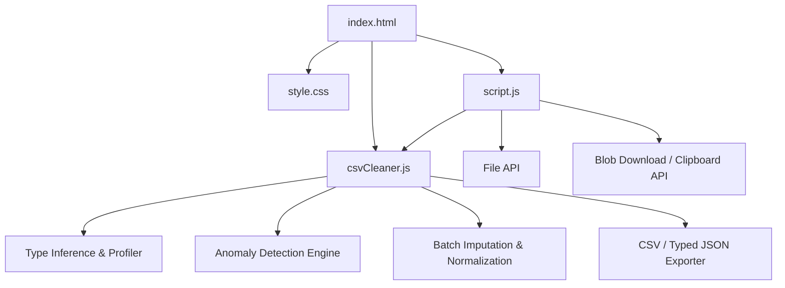

# CSV Data Cleaner & Dataset Profiler Architecture

## Overview

CSV Data Cleaner & Dataset Profiler is a browser-based data preparation and schema inference utility. It parses raw CSV files, automatically infers column data types (DateTime, Numeric, Boolean, Categorical, String), computes missing value percentages, flags anomalies (outliers, unexpected whitespace, mixed formatting), and provides one-click batch transformations (mean/median/mode imputation, row deduplication, text normalization) alongside multi-format export to CSV and typed JSON.

---

## Purpose & Goals

- Provide a zero-backend, client-side dataset cleaning and profiling environment directly in the browser.
- Deliver automated column type inference and statistical profiling (completeness, min/max, mean, median, IQR outlier boundaries, unique cardinality).
- Detect data quality anomalies (IQR numeric outliers, leading/trailing/multiple internal whitespace, and type mismatches).
- Offer one-click batch transformations: intelligent missing value imputation (mean/median/mode), text normalization, and deduplication.
- Support typed JSON export (converting numbers to numbers, booleans to booleans, empty cells to null) alongside standard RFC 4180 CSV export.
- Maintain all parsing, profiling, and transformation rules in a pure, testable JavaScript module (`csvCleaner.js`) executable in Node.js.

---

## Folder Structure

```text
csv-data-cleaner/
├── index.html       # Entry point, input panel, summary cards, profiling dashboard, and table preview
├── style.css        # Responsive styling, type badges, anomaly highlighting, and metric cards
├── script.js        # DOM events, file ingestion, batch transformation handlers, and export handling
├── csvCleaner.js    # Pure CSV parsing, column profiling, anomaly detection, imputation, and export logic
├── ARCHITECTURE.md  # Comprehensive project architecture documentation
└── thumbnail.svg    # Generated gallery thumbnail
```

---

## System / Project Architecture Overview



The system separates pure data science and transformation algorithms from DOM rendering:
1. `csvCleaner.js` operates as an independent engine with no DOM dependencies:
   - `parseCsv`: handles RFC 4180 parsing, quoted newlines, escaped quotes, and row normalization.
   - `profileColumns`: infers column types (`DateTime`, `Numeric`, `Boolean`, `Categorical`, `String`) and calculates distribution statistics (mean, median, IQR, unique values, missing percentages).
   - `detectAnomalies`: identifies numeric outliers ($< Q1 - 1.5 \times IQR$ or $> Q3 + 1.5 \times IQR$), unexpected whitespace (leading, trailing, or multiple spaces), and type mismatches.
   - `imputeMissingValues`: batch-replaces missing cells using mean, median, or mode.
   - `normalizeTextCells`: strips control characters and collapses whitespace.
   - `exportCsv` & `exportJson`: outputs cleaned datasets in RFC 4180 CSV or typed JSON.
2. `script.js` bridges the engine with user interactions:
   - Renders interactive column profiling summary cards.
   - Highlights anomalous cells in the preview table with visual indicators and hover tooltips.
   - Dispatches one-click batch transformations and manages file upload/download lifecycles.

---

## Component Breakdown

| File            | Responsibility                                                                                                                                   |
| --------------- | ------------------------------------------------------------------------------------------------------------------------------------------------ |
| `index.html`    | Provides the raw CSV text area, file uploader, batch transformation toolbar, summary metrics, column profiling dashboard, and preview table.     |
| `style.css`     | Defines the dark file-tools theme, column type badges, metric cards, anomaly cell highlighting (missing, outlier, whitespace, mixed), and grid. |
| `script.js`     | Wires UI controls, triggers cleaning/profiling, updates summary stats, renders column cards and table preview, and handles CSV/JSON downloads.   |
| `csvCleaner.js` | Pure engine: CSV parsing, column type profiling, IQR anomaly detection, whitespace/format anomaly detection, imputation, and CSV/JSON export.   |

---

## Data Flow / Execution Flow

```text
User pastes CSV text or uploads a .csv file
↓
script.js triggers CsvCleaner.analyzeCsv(text)
↓
1. CsvCleaner.parseCsv converts CSV to headers and rows
2. CsvCleaner.trimCells, removeEmptyRows, and removeDuplicateRows clean structure
3. CsvCleaner.profileColumns infers column types and calculates statistical metrics
4. CsvCleaner.detectAnomalies identifies outliers, whitespace issues, and format mismatches
↓
script.js receives dataset and summary metrics:
- Updates Summary Metric Cards (Rows, Duplicates, Empty Rows, Missing Values, Anomalies)
- Renders Column Profiling Cards (Type badge, completeness meter, summary statistics)
- Renders Preview Table with typed headers and highlighted anomaly cells with hover tooltips
↓
User applies One-Click Batch Transformations:
- "✨ Impute Missing": fills empty cells with column mean, median, or mode
- "🔤 Normalize Text": collapses whitespace, strips control characters, and trims
- "🔁 Deduplicate Rows": eliminates repeated records
↓
User exports cleaned dataset:
- "Download CSV" / "Download JSON" (typed values: numbers, booleans, nulls)
- "Copy JSON" (copies formatted JSON directly to clipboard)
```

---

## Key Features

- **Automated Column Type Inference**:
  - Automatically identifies `DateTime` (ISO, US, and Euro formats), `Numeric` (integers, floats, currency, percentages), `Boolean` (`true`/`false`, `yes`/`no`, `1`/`0`), `Categorical` (low cardinality / repeated categories), and `String` (freeform text).
- **Comprehensive Dataset Profiling**:
  - Calculates non-blank count, missing value counts, and completeness percentages per column.
  - Computes numeric distribution statistics: `min`, `max`, `mean`, `median`, `q1`, `q3`, and `iqr`.
  - Determines distinct cardinality and top frequent values.
- **Multi-Category Anomaly Detection**:
  - **Outliers**: detects values outside $[Q1 - 1.5 \times IQR, Q3 + 1.5 \times IQR]$ for numeric columns.
  - **Whitespace Anomalies**: flags leading/trailing spaces, multiple consecutive internal spaces, tabs, and non-breaking spaces.
  - **Mixed Formatting / Type Mismatches**: flags rogue non-numeric values in numeric columns or invalid dates in datetime columns.
- **One-Click Batch Transformations**:
  - **Missing Value Imputation**: configurable strategy (`auto`, `mean`, `median`, `mode`) to fill blanks without manual entry.
  - **Text Normalization**: collapses internal multiple spaces into single spaces, strips invisible control characters, and trims.
  - **Row Deduplication**: removes duplicate rows.
- **Multi-Format Export**:
  - One-click export to standard RFC 4180 CSV.
  - One-click export and clipboard copy to typed JSON (preserving native number, boolean, and null types).
- **Interactive Visual Preview**:
  - Color-coded column type badges in table headers and profile cards.
  - Visual cell indicators for missing values (red), outliers (amber), whitespace anomalies (cyan), and format mismatches (purple) with detailed explanatory tooltips.

---

## Technologies Used

| Technology          | Purpose                                                                |
| ------------------- | ---------------------------------------------------------------------- |
| HTML5               | Semantic structure, file input, accessible ARIA labels, and controls.  |
| CSS3                | Responsive grid layouts, dark mode design tokens, and anomaly styling. |
| Vanilla JavaScript  | Core parsing, statistical profiling, anomaly detection, and export.   |
| File API            | Reads uploaded CSV files directly in the browser.                      |
| Blob & URL APIs     | Generates instant client-side downloads for CSV and JSON files.        |
| Clipboard API       | Copies cleaned JSON directly to user clipboard.                        |
| Node.js `node:test` | Unit test suite for parsing, profiling, anomaly detection, and export. |

---

## File Responsibilities

### `index.html`

- Text area for raw CSV input and file upload control.
- Primary action buttons: `Load Sample`, `Clean CSV`, `Download CSV`, `Download JSON`, and `Copy JSON`.
- One-click transformation toolbar: imputation strategy selector, `Impute Missing`, `Normalize Text`, and `Deduplicate Rows`.
- Summary metric cards for row counts, duplicate removals, empty row removals, missing values, and anomalies.
- Column profiling container (`#columnProfilesWrap`) and cleaned preview table (`#tableWrap`).

### `csvCleaner.js`

- `parseCsv(text)`: robust RFC 4180 CSV parser with quote escaping and row normalization.
- `profileColumns(dataset)`: infers column types and computes statistical parameters (min, max, mean, median, IQR, unique count).
- `detectAnomalies(dataset, profiles)`: detects IQR outliers, whitespace anomalies, and mixed-type formatting inconsistencies.
- `imputeMissingValues(dataset, options)`: replaces empty cells with computed mean, median, or mode.
- `normalizeTextCells(dataset, options)`: strips control characters, replaces tabs/non-breaking spaces, and collapses whitespace.
- `exportJson(dataset, options)`: serializes dataset into an array of typed JSON objects.
- `exportCsv(dataset)`: serializes dataset into RFC 4180 CSV format.
- `cleanDataset(dataset, options)` & `analyzeCsv(text, options)`: orchestrates the end-to-end cleaning and profiling pipeline.

### `script.js`

- Ingests file uploads and handles sample dataset loading.
- Calls `CsvCleaner.analyzeCsv` and populates summary statistics and anomaly counters.
- Generates column profiling cards with completeness meters and type badges.
- Renders the preview table with highlighted anomaly cells and tooltips.
- Executes one-click imputation, normalization, and deduplication actions.
- Facilitates CSV and JSON file downloads and clipboard operations.

### `style.css`

- Dark theme palette (`#060913`, `#0f172a`, `#38bdf8`, `#fb7185`, `#f59e0b`, `#34d399`, `#a855f7`).
- Responsive workspace and transformation toolbar layout.
- Styling for type badges (`Numeric`, `DateTime`, `Boolean`, `Categorical`, `String`).
- Cell highlighting classes: `.missing`, `.anomaly-outlier`, `.anomaly-whitespace`, `.anomaly-mixed`.

---

## Design Decisions

- **Pure Engine Architecture** — `csvCleaner.js` contains no DOM or browser dependencies, allowing every profiling heuristic, anomaly test, and imputation algorithm to be unit tested in Node.js.
- **Robust Type Inference Heuristics** — columns are classified as Numeric or DateTime only when at least 85% of non-blank entries conform, preventing occasional dirty values from corrupting the inferred schema while still flagging the exceptions as format anomalies.
- **IQR Outlier Thresholding** — uses the standard Tukey boxplot rule ($Q1 - 1.5 \times IQR$ and $Q3 + 1.5 \times IQR$) to identify true extreme values without assuming normal distribution.
- **Client-Side Data Privacy** — all parsing, cleaning, profiling, and export happen entirely in browser memory; no dataset information ever leaves the user's machine.

---

## Dependencies

None. The project is completely self-contained and utilizes only native browser APIs and standard ECMAScript.

---

## Future Improvements

- Support custom date format definitions for non-standard datetime layouts.
- Allow per-column interactive imputation overrides directly from the column profile cards.
- Add boxplot and histogram sparklines directly inside column profile cards.
- Export cleaning audit logs detailing every modified cell.

---

## Known Limitations

- The parser focuses on comma-delimited files (RFC 4180) and does not currently auto-detect tab or semicolon delimiters.
- Preview table displays the first 50 rows for optimal browser DOM performance, though batch transformations and exports process the entire dataset.

---

## Development Notes

- Run locally from repository root:
  ```bash
  python -m http.server 8000
  ```
- Run unit tests:
  ```bash
  node --test tests/csv-data-cleaner.test.js
  ```

---

## License & Attribution

- **Project License:** MIT.
- **Third-Party Assets:** None.

---

## References

- [RFC 4180: Common Format and MIME Type for CSV Files](https://datatracker.ietf.org/doc/html/rfc4180)
- [MDN Web Docs: File API](https://developer.mozilla.org/en-US/docs/Web/API/File)
- [MDN Web Docs: Blob](https://developer.mozilla.org/en-US/docs/Web/API/Blob)
- [Tukey, John W. (1977). Exploratory Data Analysis. Addison-Wesley.](https://en.wikipedia.org/wiki/Interquartile_range)
