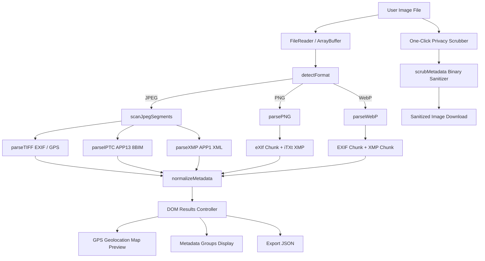

# Image Metadata Explorer & Privacy Scrubber Architecture

## Overview

Image Metadata Explorer is a browser-based forensic and privacy utility that performs deep binary inspection of EXIF, IPTC-NAA, and XMP metadata payloads stored inside image files (JPEG, PNG, and WebP). It extracts camera shooting telemetry (shutter speed, ISO, aperture, focal length, 35mm equivalent), lens specifications, device serial numbers, creator and copyright notices, and embedded GPS coordinates. It renders an interactive GPS geolocation map preview and provides a one-click binary "Scrub Metadata" privacy tool that completely sanitizes all personal, device, and geolocation markers before saving a clean copy.

The application operates 100% locally in the browser with zero server uploads, leveraging the File API, `ArrayBuffer`, and `DataView` for high-performance, private binary parsing.

---

## Purpose & Goals

- Perform deep binary parsing of EXIF, IPTC-NAA, and XMP payloads directly in the browser without server communication.
- Extract comprehensive camera telemetry: exposure time, f-number, ISO, focal length, exposure program, exposure bias, metering mode, and white balance.
- Retrieve hardware identification: body serial numbers, lens make, lens model, and lens serial numbers.
- Parse photojournalism and asset management tags: IPTC/XMP headlines, creators, credits, copyrights, captions, keywords, and city/country locations.
- Provide interactive GPS mapping: coordinate extraction with decimal conversion, radar compass visualizer, and direct OpenStreetMap / Google Maps integration.
- Deliver an instant, one-click binary Privacy Scrubber that strips EXIF, GPS, IPTC, and XMP tags from JPEG, PNG, and WebP files without lossy re-compression.
- Maintain a clean separation between pure binary processing (`metadataEngine.js`) and UI management (`script.js`).

---

## Folder Structure

```text
image-metadata-explorer/
├── ARCHITECTURE.md    # Architecture and technical documentation
├── index.html         # Page layout, preview card, GPS map, and metadata panels
├── metadataEngine.js  # Pure EXIF, IPTC, XMP binary parser and binary scrubber with UMD exports
├── script.js          # Controller: file reading, map rendering, scrubber dispatch, and JSON export
├── style.css          # Dark theme design system, GPS radar map, and responsive layouts
└── thumbnail.svg      # Gallery visual preview
```

- **tests/image-metadata-explorer.test.js**: Dedicated unit test suite covering EXIF tag extraction, IPTC parsing, XMP extraction, GPS conversions, error classification, and binary metadata scrubbing.

---

## System / Project Architecture Overview



The system strictly decouples binary parsing and serialization from DOM manipulation:
1. `metadataEngine.js` owns all raw byte processing:
   - Evaluates file headers and magic bytes (`JPEG`, `PNG`, `WebP`).
   - Scans JPEG APP markers (`APP1` EXIF/XMP, `APP2` ICC, `APP13` IPTC, `COM`).
   - Walks TIFF IFDs (IFD0, ExifSubIFD, GPSSubIFD) to extract shutter speeds, ISO, apertures, and serial numbers.
   - Decodes Photoshop 8BIM datasets for IPTC-NAA tags (headline, byline, keywords, credit, copyright).
   - Extracts Dublin Core and Photoshop properties from XMP XML packets.
   - Converts GPS degrees/minutes/seconds (DMS) to signed decimal degrees.
   - Provides `scrubMetadata` to excise metadata markers directly from binary buffers.
2. `script.js` coordinates the user interface:
   - Validates file sizes (up to 5 MB) and MIME types.
   - Loads image previews and calculates natural dimensions.
   - Renders the interactive GPS map preview and radar compass canvas.
   - Manages the one-click "Scrub Metadata" pipeline and JSON export.

---

## Component Breakdown

| File                | Responsibility                                                                                                                                           |
| ------------------- | -------------------------------------------------------------------------------------------------------------------------------------------------------- |
| `index.html`        | Structure: hero, upload card, preview pane, GPS map card, deep inspector panels, copy buttons, and action toolbar.                                     |
| `metadataEngine.js` | Core binary parsing: EXIF/TIFF, IPTC-NAA, XMP, ICC profiles, GPS conversion, error classification, and binary metadata scrubbing.                      |
| `script.js`         | UI controller: file validation, drag-and-drop, image preview, radar map drawing, one-click scrubber trigger, and JSON export.                          |
| `style.css`         | Dark theme styling, GPS radar canvas, map iframe viewport, privacy scrubber button, responsive layout (breakpoints at 950px, 700px, 520px, and 380px). |

---

## Data Flow / Execution Flow

### 1. Metadata Inspection Flow
```text
User uploads/drops an image (JPEG, PNG, WebP)
↓
script.js validates size and format → reads bytes via ArrayBuffer
↓
metadataEngine.parse(file) runs:
  - detectFormat identifies file signature
  - scanJpegSegments (or PNG/WebP chunk parsers) extract EXIF, IPTC, and XMP payloads
  - parseTIFF decodes camera settings, lens model, serial numbers, and GPS coordinates
  - parseIPTC decodes 8BIM record 2 datasets (headline, creator, copyright, keywords)
  - parseXMP decodes RDF XML tags (creator tool, dates, ratings)
  - normalizeMetadata unifies exposure, f-number, focal length, and GPS into readable formats
↓
script.js populates deep inspector panels and renders the GPS Geolocation Map card
```

### 2. Privacy Scrubber Flow
```text
User clicks "🧹 Scrub Metadata"
↓
script.js passes the raw ArrayBuffer to metadataEngine.scrubMetadata(buffer)
↓
scrubMetadata inspects format:
  - JPEG: drops APP1-APP14 (EXIF, XMP, IPTC, ICC) and COM markers; preserves SOF, DHT, DQT, and raw scan data
  - PNG: drops eXIf, tEXt, iTXt, and zTXt chunks; preserves IHDR, IDAT, PLTE, and rendering chunks
  - WebP: drops EXIF and XMP chunks; clears metadata flags in the VP8X header and adjusts RIFF length
↓
Browser downloads sanitized image (${fileName}-sanitized.${ext}) with zero metadata and identical image quality
```

---

## Key Features

- **Deep Binary EXIF Parsing**:
  - Camera telemetry: make, model, body serial number, lens make, lens model, lens serial number, software/firmware.
  - Optical settings: shutter speed, aperture, ISO, focal length, 35mm equivalent, exposure program, exposure bias, metering mode, and white balance.
- **IPTC-NAA Metadata Extraction**:
  - Photojournalism metadata: headline, title, creator/byline, credit, copyright notice, source, caption, keywords, city, province/state, and country.
- **XMP Extensible Metadata Parsing**:
  - Extracts Dublin Core titles and creators, Photoshop properties, XMP creation dates, and creator tools.
- **Interactive GPS Geolocation Map Preview**:
  - Converts raw DMS coordinate rationales into decimal degrees.
  - Renders an interactive OpenStreetMap iframe alongside an offline vector radar compass canvas.
  - Direct external navigation shortcuts for OpenStreetMap and Google Maps.
  - One-click "Copy Coordinates" button.
- **One-Click Privacy Scrubber**:
  - Completely sanitizes sensitive device telemetry, GPS coordinates, personal credits, and software signatures.
  - Pure binary manipulation avoids lossy re-encoding artifacts and preserves original image resolution.
- **Multi-Format Support**:
  - Full support for JPEG, PNG, and WebP images.
- **Zero Server Uploads**:
  - Entire analysis and scrubbing pipeline executes in-browser for complete user privacy.

---

## Technologies Used

| Technology                              | Purpose                                                                |
| --------------------------------------- | ---------------------------------------------------------------------- |
| HTML5                                   | Page structure, semantic markup, and file inputs.                      |
| CSS3 (Grid, Flexbox, Custom Properties) | Responsive layout, dark theme design tokens, and map styling.          |
| Vanilla JavaScript (ES6+)               | File API, ArrayBuffer, and DataView binary manipulation.               |
| ArrayBuffer & DataView                  | Binary TIFF, IPTC, and XMP marker parsing and chunk serialization.     |
| Canvas API (2D)                         | Rendering vector radar compass fallback and coordinate crosshairs.     |
| Blob & URL APIs                         | Client-side file preview, JSON export, and sanitized image downloads.  |
| Node.js `node:test`                     | Headless unit testing for binary parsing, GPS math, and scrubbing.     |

---

## File Responsibilities

### `metadataEngine.js`

- `parse(file)` — top-level entry: reads buffer, detects format, parses segments, and returns normalized metadata.
- `scanJpegSegments(view)` — locates EXIF, XMP, IPTC, and ICC APP markers in JPEG files.
- `parseTIFF(view, tiffStart)` — traverses TIFF IFD structures, decoding camera, exposure, serial, and GPS tags.
- `parseIPTC(view, start, length)` — parses Photoshop 8BIM datasets for IPTC-NAA photojournalism metadata.
- `parseXMP(xmpString)` — extracts Dublin Core, Photoshop, and creative tags from RDF XML packets.
- `scrubMetadata(buffer)` — binary sanitizer that removes metadata segments from JPEG, PNG, and WebP buffers.
- `gpsToDecimal(coordinates, reference)` — converts degrees, minutes, and seconds to decimal degrees.
- `normalizeMetadata(raw)` — formats exposure time, aperture, focal length, GPS, orientation, and text fields.
- `getMetadataGroups(metadata)` — groups metadata entries into categorized sections for UI display.
- `readFileBuffer(file)` & `classifyReadError(err)` — error-resilient file reading with structured error codes.

### `script.js`

- `processImage(file)` — orchestrates image preview loading and metadata extraction.
- `renderMetadata(metadata)` — populates camera, optics, GPS, IPTC, and XMP UI fields.
- `renderGPSMap(latitude, longitude)` — configures the map preview, iframe, radar canvas, and map navigation links.
- `handleScrubMetadata()` — triggers binary metadata scrubbing and downloads the sanitized file.
- `drawRadarMap(lat, lon)` — renders an animated vector radar compass on an HTML5 canvas.

### `style.css`

- Theme variables (`--bg`, `--accent`, `--card`, `--success`, `--danger`).
- Layout grids for image preview, GPS map card, and deep inspector groups.
- Styling for `.btn-scrub`, `.status-banner`, `.gps-card`, `.map-viewport`, and `.radar-map-canvas`.

---

## Design Decisions

- **Pure Binary Parsing & Scrubbing Rationale**: Parsing and scrubbing operate directly on `ArrayBuffer` and `DataView` rather than canvas image re-encoding. This ensures:
  1. No loss of original JPEG/WebP compression quality or generational loss.
  2. Complete headless testability in Node.js without browser or DOM dependencies.
  3. Support for deep metadata tags (e.g. IPTC keywords, lens serials) that HTML canvas APIs silently discard.
- **Offline Radar Map Fallback**: If external map tiles are unavailable (e.g. offline use or sandboxed environments), a vector radar compass visualizer renders on an HTML5 canvas, showing coordinate rings, crosshairs, and cardinal directions.
- **Robust Error Classification**: All file-read and permission errors are mapped to structured `FileReadError` instances with actionable codes (`PERMISSION_DENIED`, `SECURITY_ERROR`, `UNSUPPORTED_FORMAT`, `EMPTY_FILE`).

---

## Dependencies

None. The project uses only native web standards and ECMAScript.

---

## Future Improvements

- Support batch image scrubbing for folders of photos.
- Add support for HEIC/HEIF image formats via pure WebAssembly.
- Support custom copyright and watermark injection during scrubbing.

---

## Known Limitations

- Supported formats are JPEG, PNG, and WebP (standard web formats). RAW and HEIC formats require transcoding.
- Preview images are scaled to fit the viewport; original file resolution is preserved for all exports and scrubbing operations.

---

## Development Notes

- Open `index.html` through a local HTTP server:
  ```bash
  python -m http.server 8000
  ```
- Run unit tests:
  ```bash
  node --test tests/image-metadata-explorer.test.js
  ```

---

## License & Attribution

- **Project License:** MIT
- **Third-Party Assets:** None.

---

## References

- [EXIF 2.32 Specification — CIPA](https://www.cipa.jp/std/documents/e/DC-008-Translation-2019-E.pdf)
- [IPTC-NAA Information Interchange Model (IIM)](https://www.iptc.org/std/IIM/4.2/specification/IIMV4.2.pdf)
- [Adobe XMP Specification](https://www.adobe.com/devnet/xmp.html)
- [RFC 1951: DEFLATE Compressed Data Format](https://datatracker.ietf.org/doc/html/rfc1951)
