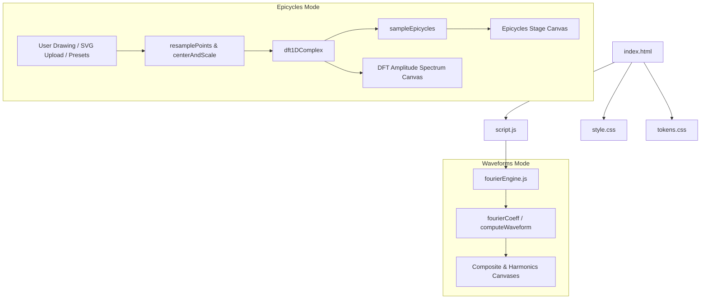

# Project Architecture

## Overview

Fourier Series Visualizer is an interactive browser-based tool that demonstrates the power of Fourier analysis in both signal processing and visual creative coding. It features two comprehensive modes:

1. **Waveform Synthesis (1D Time Domain)**: Demonstrates how periodic waveforms (square, sawtooth, triangle, sine) are constructed from harmonic sinusoidal components, with real-time harmonic toggling and progressive build animations.
2. **Epicycle & SVG Tracing (2D Complex DFT)**: Decomposes arbitrary closed 2D curves—drawn interactively by the user, selected from parametric presets, or ingested from custom SVG vector files—using a 1D Complex Discrete Fourier Transform (DFT). The resulting frequency, amplitude, and phase components drive a mechanical chain of rotating epicycles that trace the user's artwork in real time.

---

## Purpose & Goals

- Visually demonstrate Fourier series decomposition for both 1D periodic signals and 2D parametric geometry.
- Provide interactive curve sketching and custom SVG path ingestion to show how signal processing principles apply to arbitrary 2D vector shapes.
- Bridge abstract complex-variable math ($e^{i\theta} = \cos\theta + i\sin\theta$) with physical intuition through orbiting epicycle chains.
- Provide a frequency-domain DFT amplitude spectrum showing harmonic energy decay and low-pass filtering.
- Keep the codebase lightweight, modular, and dependency-free with pure mathematical functions in `fourierEngine.js`.

---

## Folder Structure

```
fourier-series-visualizer/
├── index.html          # Entry point, UI shell, mode switcher, dual workspaces
├── style.css           # Styling for waveforms, epicycles stage, controls, and themes
├── script.js           # Controller — canvas rendering, drawing input, DFT animation
├── fourierEngine.js    # Pure math engine — Fourier series coefficients & 1D complex DFT
├── ARCHITECTURE.md     # This file — technical documentation
└── thumbnail.svg       # Social preview / project card thumbnail
```

---

## System / Project Architecture Overview



---

## Component Breakdown

| File               | Responsibility                                                                                         |
| ------------------ | ------------------------------------------------------------------------------------------------------ |
| `index.html`       | Semantic structure, header mode switcher tabs, dual control panels and canvas viewports               |
| `style.css`        | Visual presentation, theme tokens, mode layouts, epicycle stage, preset grids, and dropzone styling   |
| `script.js`        | DOM controller, interactive canvas sketching, SVG parser, epicycle orbit rAF loop, and spectrum chart |
| `fourierEngine.js` | Pure math engine: Fourier coefficients, 1D complex DFT, epicycle sampling, arc-length resampling       |

---

## Data Flow / Execution Flow

### 1. 2D Epicycle Tracing & Complex DFT Flow
```text
User action (Draw on canvas / Select Preset / Upload SVG)
│
▼
Raw 2D coordinates acquired [{ x, y }]
│
▼
resamplePoints(points, N, closed=true)
  - Uniform arc-length parametrization ensures constant path velocity
│
▼
centerAndScalePoints(resampled, width, height, padding, zeroCenter=true)
  - Translates centroid to (0, 0) and fits coordinate bounds
│
▼
dft1DComplex(zeroCentered, sortByAmplitude=true)
  - Treats points as complex numbers z_n = x_n + i*y_n
  - Calculates X_k for k in [-floor(N/2), floor(N/2)]
  - Sorts components by amplitude descending (largest epicycles orbit first)
│
▼
updateAndRenderEpicycles() loop (requestAnimationFrame):
  - Increments time angle t in [0, 2π]
  - sampleEpicycles(components, t, K, origin) computes circle centers and tip
  - Draws reference path, traced glow curve, orbiting circles, radii vectors, and tip
  - Renders DFT Amplitude Spectrum bar chart with active cutoff line
```

---

## Key Features

- **Dual-Mode Visualizer**: Seamless switching between 1D periodic waveform decomposition and 2D complex Fourier epicycle path tracing.
- **Interactive Canvas Drawing**: Users can sketch any freeform closed curve using mouse, pen, or touch directly on the canvas; upon release, the stroke is automatically digitized, resampled, and traced by epicycles.
- **Custom SVG Vector Ingestion**: Upload custom `.svg` files or paste raw SVG path data (`d="..."`) to decompose arbitrary vector logos and shapes.
- **Parametric Geometric Presets**: Instant access to built-in presets: Heart, 5-Pointed Star, Lemniscate of Bernoulli (Infinity), Butterfly, Fourier $\pi$, and Circle.
- **1D Complex Discrete Fourier Transform**: Exact complex DFT algorithm mapping $z_n = x_n + i y_n$ into frequency, amplitude, and phase components.
- **Concentric Amplitude Sorting**: Epicycles are sorted in descending order of radius, ensuring macro structure orbits first while micro details refine the outer perimeter.
- **Dynamic Harmonics Truncation & Low-Pass Filtering**: Slider controls the number of active epicycles $K \le N$, demonstrating real-time Fourier series approximation and feature smoothing.
- **DFT Amplitude Spectrum Chart**: Visualizes spectral energy distribution $|X_k|$ across harmonics with real-time energy capture percentage.
- **Multiple Visual Themes & Toggles**: Supports Neon Indigo, Spectral Rainbow, Cyber Amber, and Aurora Emerald palettes with toggles for epicycle circles, radii vectors, trace path, and reference contours.

---

## Mathematical Formulation

### 1. Complex 1D Discrete Fourier Transform
For a sequence of $N$ points in the 2D plane treated as complex numbers $z_n = x_n + i y_n$ for $n = 0, 1, \dots, N-1$:

$$X_k = \frac{1}{N} \sum_{n=0}^{N-1} z_n \cdot e^{-i \cdot \frac{2\pi k n}{N}}$$

Using Euler's identity $e^{-i\theta} = \cos\theta - i\sin\theta$:

$$\text{Re}(X_k) = \frac{1}{N} \sum_{n=0}^{N-1} \big(x_n \cos\theta + y_n \sin\theta\big)$$
$$\text{Im}(X_k) = \frac{1}{N} \sum_{n=0}^{N-1} \big(y_n \cos\theta - x_n \sin\theta\big)$$

where $\theta = \frac{2\pi k n}{N}$.

### 2. Amplitude and Phase
$$\text{amp}_k = \sqrt{\text{Re}(X_k)^2 + \text{Im}(X_k)^2}$$
$$\phi_k = \text{atan2}\big(\text{Im}(X_k), \text{Re}(X_k)\big)$$

### 3. Continuous Epicycle Reconstruction
At continuous time $t \in [0, 2\pi]$:

$$z(t) = \sum_{k=0}^{K-1} \text{amp}_k \cdot \big(\cos(k t + \phi_k) + i \sin(k t + \phi_k)\big)$$

---

## Technologies Used

| Technology                                          | Purpose                                             |
| --------------------------------------------------- | --------------------------------------------------- |
| HTML5                                               | Page structure and semantic markup                  |
| CSS3 (Grid, Flexbox, Custom Properties)             | Layout and responsive design                        |
| Vanilla JavaScript (ES6+, Canvas API)               | Rendering, controls, animation                      |
| Font Awesome 6.5.1 (CDN)                            | UI icons                                            |
| Google Fonts (Space Grotesk, Inter, JetBrains Mono) | Typography                                          |
| Cradle tokens.css                                   | Shared design tokens (colours, spacing, typography) |

---

## File Responsibilities

### `fourierEngine.js`

- `fourierCoeff(waveType, n)` — returns `{a, b}` coefficients for harmonic n of any wave type
- `computeWaveform(waveType, numHarmonics, frequency, sampleRate, duration, activeFilter)` — samples the full Fourier sum across time
- `sampleAt(waveType, numHarmonics, frequency, time, activeFilter)` — single-point waveform sample for per-harmonic rendering
- `buildProgressiveFrames(waveType, maxHarmonics, frequency, sampleRate, duration)` — pre-computed frames for build-up animation
- `normalise(samples)` — scales samples to the [-1, 1] range
- `dft1DComplex(points, sortByAmplitude)` — pure 1D complex Discrete Fourier Transform on 2D coordinates $z_n = x_n + i y_n$
- `sampleEpicycles(components, time, maxEpicycles, origin)` — evaluates rotating circle centers, vector angles, and final tip position at continuous angular time $t$
- `resamplePoints(points, targetCount, closed)` — produces equidistant points partitioned uniformly along cumulative arc-length
- `centerAndScalePoints(points, targetWidth, targetHeight, padding, zeroCenter)` — centers point cloud and scales to canvas bounds
- `computeDftEnergy(components, maxEpicycles)` — computes spectral variance and energy percentage captured by the first $K$ harmonics
- `parseSvgPathToPoints(pathData, sampleCount)` & `fallbackParseSvgCoordinates(pathData, sampleCount)` — extracts and samples vector coordinates from SVG paths
- `generateParametricShape(shapeName, pointCount)` — parametric coordinate generator for Heart, Star, Infinity, Butterfly, Pi, and Circle presets

### `script.js`

- `state` & `epicycleState` — state machines for 1D waveforms and 2D complex epicycles
- `switchVisualizerMode(mode)` — tab controller synchronizing DOM viewports, canvas resize observer, and animation loops
- `initDrawingOnCanvas()` — pointer capture listeners (`pointerdown`, `pointermove`, `pointerup`) for interactive sketching
- `handleSvgFile(file)` & `loadSvgPathBtn` — file ingestion, drag-and-drop handler, and SVG DOM parser
- `loadPreset(presetName)` & `loadEpicycleShapeFromPoints(rawPoints)` — pipeline connecting vector data to DFT decomposition
- `updateAndRenderEpicycles(timestamp)` — 60 FPS animation loop driving continuous orbit and tip accumulation
- `renderEpicyclesStage()` — renders coordinate grid, reference path, glowing traced trail, rotating circles, and radii vectors
- `renderSpectrumCanvas()` — renders DFT amplitude bar chart with active harmonics cutoff marker
- `resizeCanvas()` / `resizeAllCanvases()` — Retina DPR scaling and canvas context transformation

### `style.css`

- CSS custom properties under `:root` — harmonic color palettes, canvas backgrounds, and theme variables
- `.mode-nav` / `.mode-tab-btn` — mode switcher navigation tabs in header
- `.source-grid` / `.preset-grid` — input source tabs, preset buttons, and SVG upload dropzone
- `.epicycles-stage-wrap` / `.draw-canvas-hint` — interactive canvas stage, drawing hint overlay, and crosshair coordinates
- `.toggle-list` / `.metrics-grid` — toggle controls and mathematical DFT analysis cards
- Responsive breakpoints at 900px and 600px
- Full light & dark theme styling with smooth CSS transitions

---

## Design Decisions

- **Complex Coordinates for 2D Geometry** — By pairing 2D $(x, y)$ coordinates into complex numbers $z = x + i y$, a single 1D complex DFT solves both coordinates simultaneously without needing separate $X(t)$ and $Y(t)$ transforms, producing unified rotating epicycles in the 2D plane.
- **Amplitude-Descending Epicycle Sorting** — Sorting Fourier frequency components by descending radius ($|X_k|$) creates the iconic Grant Sanderson (3Blue1Brown) epicycle chain: the largest circular motion establishes the primary macro contour, while subsequent smaller circles refine corners and intricate details.
- **Uniform Arc-Length Resampling** — Freehand mouse/touch gestures produce irregular point densities due to varying hand speeds. Partitioning the path's cumulative distance into $N$ equidistant intervals normalizes traversal velocity so the epicycle tip traces the curve smoothly.
- **Zero-Centered DFT Normalization** — Centering points around $(0, 0)$ prior to DFT computation sets the DC offset ($k=0$) near zero, allowing the epicycle chain to anchor cleanly at the center of the visualizer canvas.
- **Pure Math Engine Separate from DOM** — `fourierEngine.js` has zero DOM dependency and uses a UMD export wrapper, allowing all DFT formulas, epicycle kinematic evaluations, and resampling algorithms to be unit-tested directly in Node.js.
- **Dual-Mode Architecture** — Preserves complete backward compatibility with the existing 1D waveform visualizer while offering an intuitive tabbed switch to the 2D epicycle tracing engine.

---

## Dependencies

| Dependency                             | Version | How loaded       | Purpose                |
| -------------------------------------- | ------- | ---------------- | ---------------------- |
| Font Awesome                           | 6.5.1   | CDN (`<link>`)   | UI icons               |
| Space Grotesk / Inter / JetBrains Mono | —       | Google Fonts CDN | Typography             |
| Cradle tokens.css                      | —       | Local stylesheet | Shared design tokens   |
| Cradle BackToHome.js                   | —       | Local script     | Home navigation button |

All runtime dependencies are loaded via CDN or local reference. There is no build step, package manager, or npm dependency.

---

## Future Improvements

- Add audio synthesis so users can hear the waveform at the selected frequency and harmonics
- Add a spectrogram or frequency-domain view alongside the time-domain waveform
- Allow users to draw/customise their own waveform and see its Fourier decomposition
- Support adjustable phase offsets per harmonic

---

## Known Limitations

- The animation build mode cycles through harmonics mathematically but does not currently animate smoothly — it snaps between harmonic counts. A future improvement could interpolate.
- Performance degrades slightly above 15 harmonics on low-end devices (the canvas is redrawn per frame with all harmonic lines).
- Only time-domain visualisation is shown — no frequency-domain (spectrum) view is provided yet.

---

## Development Notes

- Open `index.html` through a local server (e.g. `python3 -m http.server 8000`), not by double-clicking. The `file://` protocol may block some CDN font and icon resources.
- Run unit tests with Node.js: `node tests/fourier-series-visualizer.test.js`
- `fourierEngine.js` is designed as a standalone module: `const { fourierCoeff } = require('./fourierEngine.js')`
- No build step is required. Edit any file and refresh the browser.

---

## License & Attribution

- **Project License:** MIT
- **Third-Party Assets:**
  - 'Space Grotesk', 'Inter', and 'JetBrains Mono' fonts by [Google Fonts](https://fonts.google.com) (OFL License)
  - Font Awesome 6.5.1 icons by [Fonticons, Inc.](https://fontawesome.com) (CC BY 4.0)

---

## References

- [Fourier Series — Wikipedia](https://en.wikipedia.org/wiki/Fourier_series) — coefficient formulas for square, sawtooth, and triangle waves
- [3Blue1Brown — Fourier Series](https://www.youtube.com/watch?v=r6sGWTCMz2k) — visual intuition for the underlying math
- [MDN Web Docs — Canvas API](https://developer.mozilla.org/en-US/docs/Web/API/Canvas_API)
