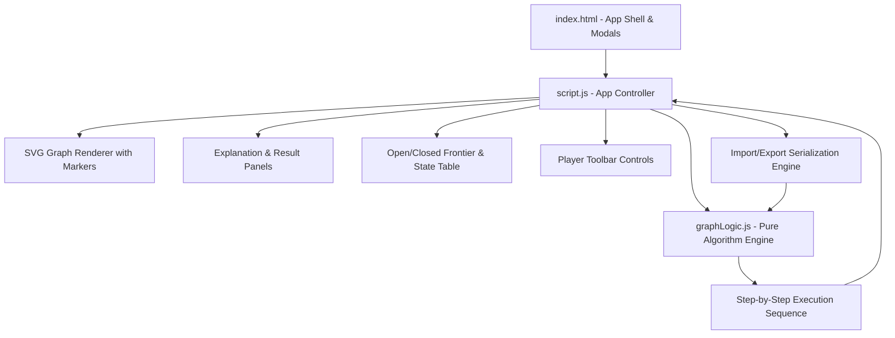

# Project Architecture - Graph Theory Explorer

This document describes the architecture and structure of the **Graph Theory Explorer** project located in `projects/math/graph-theory-explorer/`.

---

## Overview

Graph Theory Explorer is an interactive graph visualization and algorithm simulation laboratory designed for computer science students, competitive programmers, and software engineers. The platform enables users to build, edit, and explore graphs interactively with support for both undirected and directed edges.

The algorithmic execution engine supports **Dijkstra's Shortest Path**, **Prim's and Kruskal's Minimum Spanning Tree (MST)**, **Kahn's Topological Sorting**, and **Tarjan's Strongly Connected Components (SCC)**, paired with animated step-by-step playback controls (play, pause, step forward/backward, speed slider), an open/closed frontier table inspection view, and standard import/export formats (Adjacency Matrix, Edge List, JSON).

---

## Purpose & Goals

- Teach graph traversal, shortest paths, spanning trees, DAG ordering, and connectivity through interactive visualization.
- Implement competitive programming algorithms: Dijkstra, Prim's MST, Kruskal's MST (with Disjoint Set Union), Kahn's Topological Sort, and Tarjan's SCC.
- Provide step-by-step playback with forward/backward stepping, pause/resume, and speed control.
- Offer an Open/Closed frontier and state inspection view that reveals internal data structures (queues, call stacks, disjoint sets, in-degrees, and low-link numbers).
- Provide robust import and export capabilities across Adjacency Matrix (CSV), Edge List, and JSON formats.
- Keep the algorithm engine completely pure and DOM-free for headless unit testing in Node.js.

---

## Folder Structure

```text
projects/math/graph-theory-explorer/
+-- ARCHITECTURE.md    # Architecture documentation and implementation notes
+-- graphLogic.js      # Pure algorithm execution engine, DSU, and serialization utilities
+-- index.html         # App shell, control sidebar, SVG workspace, frontier table, and IO modal
+-- script.js          # App controller, graph editing, SVG rendering, animation player, and modal UI
+-- style.css          # Responsive design, theme tokens, frontier cards, markers, and modal styles
+-- thumbnail.svg      # Project thumbnail graphic
```

---

## System / Project Architecture Overview



---

## Component Breakdown

| File            | Role                                                                                                                                                              |
| --------------- | ----------------------------------------------------------------------------------------------------------------------------------------------------------------- |
| `index.html`    | Declares algorithm selectors, node pickers, directed toggle, SVG canvas workspace, frontier inspection table, stepper player, and import/export modal.         |
| `style.css`     | Handles responsive layout, SVG node/edge highlighting, directed arrow markers, open/closed frontier chips, state telemetry table, and modal dialog presentation. |
| `script.js`     | Controller managing in-memory graph state, SVG rendering, click/drag editing, animation stepper, live frontier table updates, and import/export flows.           |
| `graphLogic.js` | Pure algorithm engine implementing DSU, BFS, DFS, Prim's, Kruskal's, Dijkstra, Kahn's Topo Sort, Tarjan's SCC, and matrix/edge-list/JSON converters.           |

---

## Data Flow / Execution Flow

```text
User creates/edits graph, selects algorithm, or imports data
        |
        v
script.js updates in-memory nodes, edges, and directed state
        |
        v
graphLogic.js computes structured step sequence with open/closed telemetry
        |
        v
script.js stores step timeline for forward/backward playback
        |
        v
Player engine renders SVG graph, updates explanation text,
and renders live Open/Closed frontier chips and state table
```

---

## State Model

The client maintains graph state in browser memory:

```javascript
nodes: [{ id: "A", x: 450, y: 280 }]
edges: [{ from: "A", to: "B", weight: 4 }]
directed: false // boolean: undirected vs. directed graph
algorithm: "bfs" | "dfs" | "dijkstra" | "mst" | "kruskal" | "topo" | "scc"
mode: "add-node" | "add-edge"
steps: [...] // array of step objects
stepIndex: active playback step (-1 to steps.length - 1)
playing: boolean
speed: 300ms to 2500ms per step
```

`graphLogic.js` operates purely on the minimal mathematical graph model:
- `nodes`: `[{ id: string }]`
- `edges`: `[{ from: string, to: string, weight?: number }]`

---

## Algorithm Layer

`graphLogic.js` provides:

1. **`buildAdjacency(nodes, edges, directed)`** — Generates adjacency lists supporting both directed and undirected graphs.
2. **`bfs(nodes, edges, startId, directed)`** — Breadth-first traversal with active queue and visited tracking.
3. **`dfs(nodes, edges, startId, maxDepth, directed)`** — Depth-first traversal with call-stack depth limits.
4. **`primMST(nodes, edges, startId)`** — Prim's greedy cut-crossing edge selection for minimum spanning trees.
5. **`kruskalMST(nodes, edges)`** — Kruskal's algorithm using Disjoint Set Union (DSU with union by rank and path compression) to sort edges and reject cycle-forming connections.
6. **`dijkstra(nodes, edges, startId, endId, directed)`** — Shortest-path distance relaxation and predecessor back-tracing.
7. **`kahnTopologicalSort(nodes, edges)`** — DAG topological ordering via in-degree calculation, zero in-degree queue extraction, and cycle detection.
8. **`tarjanSCC(nodes, edges)`** — Strongly Connected Components decomposition using DFS discovery (`disc`) and low-link (`low`) numbers with stack tracking.

Every algorithm returns structured step entries containing:
- `type`: `visit`, `frontier-edge`, `tree-edge`, `reject-edge`, `settle`, `relax`, `enqueue`, `scc-found`, or `info`.
- `description`: Detailed explanation of the operation performed.
- `openSet`: Elements currently in the active frontier (queue, priority candidates, call stack, or disjoint sets).
- `closedSet`: Elements currently settled, visited, or finalized into components.
- `stateTable`: Live telemetry mappings (distances, in-degrees, or discovery/low-link pairs).

---

## Open / Closed Frontier Table Inspection

The Frontier Inspection card renders:
- **Open Set / Frontier**: Real-time chips displaying pending queue items, candidate edges, or active DFS stack nodes.
- **Closed Set / Settled**: Visual badges representing finalized nodes, tree edges, or closed components.
- **Node Telemetry Table**:
  - *Dijkstra*: Node ID, Status (Settled / Current / Frontier / Unvisited), Shortest Distance from source.
  - *Topological Sort*: Node ID, Status (Ordered / In Queue / Pending), In-Degree count.
  - *Tarjan's SCC*: Node ID, Status (In SCC / On Stack / Visiting / Unvisited), `disc` and `low` metrics.
  - *MST & Traversals*: Node/Edge ID, Status (Visited / Frontier / Pending), Telemetry details.

---

## Import / Export Specifications

The application includes an integrated dialog supporting three standardized formats:
1. **Adjacency Matrix (CSV)**:
   - Header with comma-separated node IDs.
   - Row-by-row cell weights (0 for non-adjacent pairs).
2. **Edge List**:
   - Lines formatted as `from to [weight]`.
   - Optional `# Isolated nodes: ...` comments.
3. **JSON Schema (v2.0)**:
   ```json
   {
     "version": "2.0",
     "directed": false,
     "nodes": [{ "id": "A", "x": 450, "y": 280 }],
     "edges": [{ "from": "A", "to": "B", "weight": 4 }]
   }
   ```
Features include one-click clipboard copying, downloadable file exports, and validation feedback.

---

## Rendering Strategy

- **SVG Canvas Workspace**: Nodes and edges are native SVG elements (`<circle>`, `<line>`, `<text>`).
- **Directed Graph Arrowheads**: SVG `<marker id="arrow-marker">` elements attach to directed edges. Directed edges are mathematically shortened by the node radius (20px) so arrowheads cleanly meet circle perimeters.
- **Visual Feedback & Animation**:
  - Edge classes (`.active-edge`, `.frontier-edge`, `.tree-edge`, `.path-edge`, `.reject-edge`) with keyframe animations (`@keyframes edge-flow`, `@keyframes edge-glow`, `@keyframes reject-flash`) for real-time edge exploration.
  - Node classes (`.visited`, `.current`, `.frontier`, `.on-path`) with keyframe pulsing ring animations (`@keyframes node-pulse-ring`) for active traversal focus.
  - On-canvas telemetry badges (`.node-badge`) rendering dynamic intermediate values (`d:...`, `in:...`, `disc/low`) directly beneath node circles.
  - Live intermediate results panel dynamically recalculating running metrics (e.g. running MST weight, in-degrees, distance relaxations, active stack) on every single playback step.
  - Keyboard playback shortcuts (`Space` to play/pause, `←`/`→` to step, `R` to reset).

---

## Testing Notes

All algorithm logic in `graphLogic.js` is isolated and exported via CommonJS and `window.GraphLogic`. Headless unit tests in `tests/graph-theory-explorer-logic.test.js` validate:
- BFS & DFS traversals
- Prim's and Kruskal's MST weight correctness and cycle rejection
- Dijkstra shortest path accuracy and unreachable node handling
- Kahn's topological ordering and cycle detection
- Tarjan's Strongly Connected Component decomposition
- Round-trip fidelity for Adjacency Matrix, Edge List, and JSON serialization

---

## Key Features

- **7 Core Graph Algorithms**: BFS, DFS, Dijkstra, Prim's MST, Kruskal's MST, Kahn's Topological Sort, and Tarjan's SCC.
- **Undirected & Directed Graph Modes**: Seamless toggle with arrowhead markers.
- **Interactive Step-by-Step Playback**: Play, pause, step forward, step backward, restart, and speed slider.
- **Frontier & State Inspector**: Open/closed set chips and node telemetry table.
- **3 Import/Export Formats**: Adjacency Matrix, Edge List, and JSON with clipboard copy and file downloads.
- **Drag-to-Move Nodes & Click-to-Connect Edges**: Interactive SVG canvas manipulation.
- **Random Graph Generator & Clear All**: Quick generation of ring-and-chord graphs.
- **Light & Dark Theme**: Cradle design token compliance.

---

## Technologies Used

| Technology                                          | Purpose                                           |
| --------------------------------------------------- | ------------------------------------------------- |
| HTML5                                               | Semantic layout, canvas workspace, modal dialogs  |
| CSS3 (Flexbox, Grid, Custom Properties)             | Responsive styling, frontier tables, themes       |
| Vanilla JavaScript (ES6+)                           | Graph state management, playback animation        |
| SVG & SVG Markers                                   | Scalable node/edge rendering and arrow markers    |
| Font Awesome 6.5.1 (CDN)                            | User interface icons                              |
| Cradle tokens.css & BackToHome.js                   | Shared design system and navigation               |

---

## File Responsibilities

| File                 | Responsibility                                                                                                   |
| -------------------- | ---------------------------------------------------------------------------------------------------------------- |
| `index.html`         | App structure, algorithm options, directed toggle, player toolbar, frontier inspection view, and IO modal.       |
| `style.css`          | Styling for graph nodes, edges, directed markers, frontier cards, telemetry tables, and import/export modal.      |
| `script.js`          | App controller, canvas editing, SVG rendering, animation stepping, frontier table updates, and IO modal wiring. |
| `graphLogic.js`      | Pure algorithms (BFS, DFS, Prim, Kruskal, Dijkstra, Kahn, Tarjan) and serialization utilities.                  |
| `thumbnail.svg`      | Preview graphic for the project catalog.                                                                         |
| `ARCHITECTURE.md`    | Architecture specification and design documentation.                                                             |

---

## Design Decisions

- **Pure Functional Algorithm Engine**: Keeping `graphLogic.js` free of DOM references enables comprehensive headless unit testing.
- **Precomputed Timeline of Steps**: Generating an immutable sequence of steps upfront simplifies forward/backward stepping without complex state rollbacks.
- **Dynamic Frontier Schema**: The frontier table dynamically alters columns based on algorithm semantics (distances for Dijkstra, in-degrees for Kahn, low-links for Tarjan, cuts for Prim/Kruskal).
- **Geometric Edge Shortening**: Shortening directed SVG lines by node radii ensures arrowheads never render behind node circles.

---

## Dependencies

| Dependency                             | Version | How loaded       | Purpose                |
| -------------------------------------- | ------- | ---------------- | ---------------------- |
| Font Awesome                           | 6.5.1   | CDN (`<link>`)   | UI icons               |
| Space Grotesk / Inter / JetBrains Mono | —       | Google Fonts CDN | Typography             |
| Cradle tokens.css                      | —       | Local stylesheet | Shared design tokens   |
| Cradle BackToHome.js                   | —       | Local script     | Home navigation button |

---

## Future Improvements

- Add A* search with Euclidean coordinate heuristics.
- Add Floyd-Warshall all-pairs shortest paths visualizer.
- Add graph coloring algorithms (Welsh-Powell).

---

## Known Limitations

- Large graphs with more than 50 nodes may crowd the SVG canvas without pan-and-zoom controls.
- Edge weights are entered via dialog prompts.

---

## Development Notes

- Serve the directory over a local HTTP server for Cradle asset resolution.
- Run validation scripts:
  - `node scripts/validate-no-dynamic-eval.js`
  - `node scripts/validate-accessible-labels.js`
  - `node scripts/validate-mini-projects.js`
  - `node scripts/validate-architecture-docs.js`

---

## License & Attribution

- **Project License:** MIT
- **Third-Party Assets:**
  - Font Awesome 6.5.1 (CC BY 4.0)
  - Google Fonts (OFL License)

---

## References

- [Kruskal's algorithm — Wikipedia](https://en.wikipedia.org/wiki/Kruskal%27s_algorithm)
- [Prim's algorithm — Wikipedia](https://en.wikipedia.org/wiki/Prim%27s_algorithm)
- [Dijkstra's algorithm — Wikipedia](https://en.wikipedia.org/wiki/Dijkstra%27s_algorithm)
- [Topological sorting (Kahn's algorithm) — Wikipedia](https://en.wikipedia.org/wiki/Topological_sorting)
- [Tarjan's strongly connected components algorithm — Wikipedia](https://en.wikipedia.org/wiki/Tarjan%27s_strongly_connected_components_algorithm)
