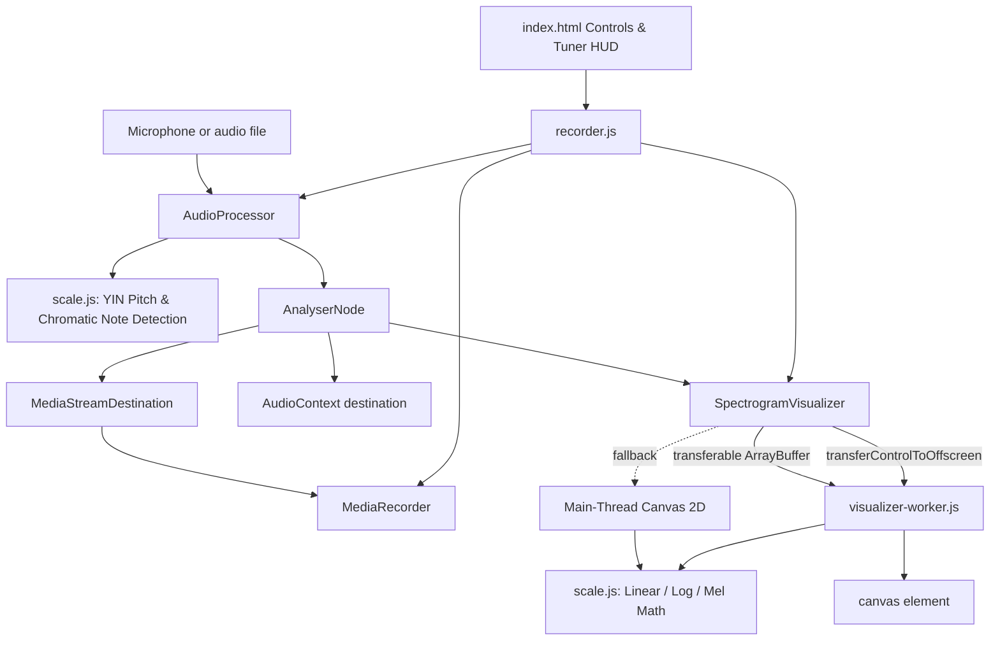

# Real-time Audio Spectrogram Analyzer - Architecture

## Overview

The Audio Spectrogram Analyzer captures audio from a microphone or a local file, routes it through the Web Audio API, and draws a scrolling time-frequency heatmap on a canvas. The visualizer features calibrated Y-axis frequency ticks with selectable Linear, Logarithmic, and perceptual Mel-scale frequency distributions, scrolling time markers, real-time fundamental frequency ($F_0$) pitch detection via the autocorrelation/YIN algorithm, a chromatic note tuner with a $\pm 50$ cent deviation meter, harmonic peak tracking ($F_0, 2F_0, 3F_0, \dots$), an interactive canvas hover cursor displaying exact frequency, magnitude (dBFS), and nearest musical pitch, and a dynamic dBFS colorbar. The processed signal can be recorded locally and downloaded as a WebM file.

The application is a static collection of ES modules. It has no build step and no backend; microphone capture, audio processing, pitch detection, and recording happen entirely in the browser.

## Purpose & Goals

- Demonstrate real-time audio analysis with `AnalyserNode`, `getByteFrequencyData`, and time-domain autocorrelation.
- Provide an educational, research-grade acoustic inspection tool for sound analysis, speech phonetics, and instrument tuning.
- Support Linear, Logarithmic, and Mel-scale frequency mappings for inspecting musical notes, vowel formants, and high-frequency harmonics.
- Detect fundamental frequency ($F_0$) in real time using the robust autocorrelation/YIN algorithm with sub-sample parabolic interpolation and RMS noise-gating.
- Map detected frequencies to standard 12-Tone Equal Temperament (12-TET) musical chromatic notes with a $\pm 50$ cent deviation tuning meter.
- Track harmonic overtones ($1\times, 2\times, 3\times, \dots$) on both the visual spectrogram and a dedicated harmonics telemetry dashboard.
- Provide an interactive hover cursor that pinpoints exact frequency (Hz), magnitude (dBFS), and nearest musical pitch with crosshair guidelines.
- Display a dynamic dBFS colorbar with real-time signal peak indicators.
- Render at 60 FPS by delegating heavy canvas rendering to a dedicated Web Worker via `transferControlToOffscreen()`, with seamless main-thread fallback.
- Support both live microphone input and local audio files.
- Record the exact signal being visualized through a `MediaStreamDestination`.

## Folder Structure

```text
audio-spectrogram-analyzer/
|--  index.html            # Controls, Tuner HUD, canvas, tooltip, dBFS legend, and recording buttons
|--  style.css             # Responsive layout, Tuner meter, interactive tooltip, dark/light theme
|--  scale.js              # Linear/Log/Mel scales, YIN pitch detection, chromatic notes, dBFS conversions
|--  audio-processor.js    # Web Audio graph, analyser, time/frequency buffers, pitch & harmonic analysis
|--  visualizer.js         # Visualizer controller, OffscreenCanvas worker delegation, hover interaction
|--  visualizer-worker.js  # Dedicated Web Worker for off-thread pixel mapping, crosshair, and frame composition
|--  recorder.js           # MediaRecorder integration, Tuner HUD updates, tooltip display, bootstrap
|--  ARCHITECTURE.md       # This document
`--  thumbnail.svg         # Preview thumbnail used by the project registry
```

## System / Project Architecture Overview

The application is split into specialized modules with clear responsibilities:
- `AudioProcessor` owns the Web Audio graph, source routing, time-domain and frequency data acquisition, and harmonic peak calculations.
- `scale.js` provides pure mathematical frequency conversions (Linear, Log, Mel), chromatic note mapping, and the YIN pitch detection algorithm.
- `SpectrogramVisualizer` manages canvas lifecycle, hover cursor interaction, and delegates pixel processing to `visualizer-worker.js` via `transferControlToOffscreen()` (falling back to main-thread Canvas 2D if unsupported).
- `recorder.js` wires UI controls, updates the Chromatic Tuner HUD and hover tooltip, and manages `MediaRecorder`.



## Component Breakdown

| Component                   | Responsibility                                                                                                                                                              |
| --------------------------- | --------------------------------------------------------------------------------------------------------------------------------------------------------------------------- |
| `scale.js`                  | Pure mathematical conversions for Linear/Logarithmic/Mel scales, YIN autocorrelation pitch detection, chromatic 12-TET note conversion, dBFS math, and tick generation.     |
| `AudioProcessor`            | Creates `AudioContext`, routes mic/file audio, manages `AnalyserNode`, extracts time/frequency buffers, runs pitch detection, calculates harmonic peaks, and exposes streams. |
| `SpectrogramVisualizer`     | Orchestrates visualizer lifecycle, manages mouse/pointer hover coordinates, delegates rendering to `visualizer-worker.js`, and provides main-thread Canvas 2D fallback.     |
| `SpectrogramWorkerRenderer` | Worker-scope renderer (`visualizer-worker.js`) executing pixel mapping, waterfall scrolling, crosshair rendering, and axes compositing off the main UI thread.             |
| `recorder.js`               | Binds DOM controls, updates the Chromatic Tuner HUD and hover tooltip, manages `MediaRecorder`, creates download blobs, and cleans up audio on unload.                    |
| `index.html`                | Provides audio source, FFT size, and Scale selectors, Chromatic Tuner HUD, canvas container with hover tooltip, dBFS legend, and error banner.                            |
| `style.css`                 | Defines responsive layout, Tuner card & cent meter, glassmorphic hover tooltip, theme palettes, and calibrated legends.                                                     |

## Data Flow / Execution Flow

1. `DOMContentLoaded` initializes `AudioProcessor` and `SpectrogramVisualizer`, then binds controls including FFT size and frequency scale (Linear, Logarithmic, Mel).
2. The user initiates audio capture via **Start Microphone** (`getUserMedia`) or **Upload Audio File** (`<audio>` element).
3. `setupAnalyser()` creates a 2048-point `AnalyserNode`, connecting the source to speakers, the recording destination, and the analyser.
4. On each animation frame, `visualizer.draw(audioProcessor)`:
   - Queries `audioProcessor.getFrequencyData()` (`Uint8Array`) and computes live peak decibels.
   - Runs `audioProcessor.detectPitch()`, executing the YIN autocorrelation algorithm on time-domain samples (`Float32Array`) to extract fundamental frequency ($F_0$), harmonic clarity, and nearest musical note.
   - Dispatches pitch data to `onPitchUpdate` to animate the Chromatic Tuner HUD needle ($\pm 50¢$ deviation) and update harmonic peak chips ($F_0, 2\times, 3\times, 4\times$).
   - Passes frequency buffers and active pitch $F_0$ to the rendering pipeline (Web Worker or main-thread fallback).
5. The renderer scrolls its offscreen waterfall buffer by 2 pixels, maps frequency rows according to the selected scale mode (`Linear`, `Logarithmic`, or `Mel`), composites time and frequency axes, and overlays $F_0$ harmonic tracking lines.
6. When the user moves their cursor over the spectrogram, pointer events calculate coordinates, map Y to exact frequency (Hz), look up magnitude (dBFS), determine the nearest musical note, and display an interactive glassmorphism tooltip and crosshairs.
7. Recording wraps a `MediaRecorder` around the destination stream. When stopped, chunks are bundled into a Blob and downloaded as a WebM file.
8. On unload or stop, media tracks are stopped, object URLs revoked, audio nodes disconnected, and audio contexts safely closed.

## Key Features

- **Mel-Scale Frequency Mapping** - Models human perceptual pitch intervals ($m = 2595 \times \log_{10}(1 + f/700)$), providing balanced acoustic resolution for speech formants and musical analysis.
- **Linear & Logarithmic Scales** - Preserves physical frequency spacing (Linear) and octave-based distribution (Log) alongside the Mel scale.
- **Real-Time Fundamental Frequency ($F_0$) Detection** - Implements the de Cheveigné & Kawahara YIN autocorrelation algorithm with sub-sample parabolic interpolation and RMS noise-gating for rock-solid pitch tracking.
- **12-TET Chromatic Note & Cent Meter HUD** - Maps detected frequencies to musical note names (e.g., A4, C5) with a live $\pm 50$ cent deviation needle and an "In Tune" ($\pm 5¢$) visual indicator.
- **Harmonic Peak Tracking** - Overlays fundamental ($F_0$) and harmonic overtone ($2\times, 3\times$) guide lines directly onto the spectrogram and displays real-time harmonic telemetry chips.
- **Interactive Spectrogram Hover Cursor** - Hovering over the canvas reveals crosshair guides and a floating HUD tooltip displaying exact frequency (Hz), magnitude (dBFS), and nearest chromatic pitch.
- **Dedicated OffscreenCanvas Web Worker** - Offloads pixel transformation and compositing to a worker thread, guaranteeing 60 FPS UI performance.
- **Calibrated Physical Axes & Scrolling Time Markers** - Formatted Hz/kHz ticks and dynamic scrolling time markers (0s, -1s, -2s) provide precise spatio-temporal references.
- **Dynamic dBFS Colorbar** - Calibrated decibel legend with smoothed peak tracking needle and digital level readout.
- **Local WebM Recording** - Captures audio through a `MediaStreamDestination` for one-click downloading.
- **Zero Runtime Dependencies** - Implemented in 100% vanilla JavaScript, HTML5, and CSS3.

## Technologies Used

- Web Audio API: `AudioContext`, `AnalyserNode`, `MediaStreamAudioSourceNode`, `MediaElementAudioSourceNode`, `MediaStreamDestination`.
- Time-domain pitch estimation: YIN autocorrelation algorithm with parabolic interpolation.
- Frequency scales: Linear, Logarithmic ($\log_{10}$), and Mel scale ($2595 \log_{10}(1 + f/700)$).
- Equal temperament tuning: 12-TET chromatic frequency-to-note mapping and cent deviation calculation.
- HTML5 Canvas 2D & OffscreenCanvas with dedicated Web Worker delegation.
- Media Capture and Streams API & MediaRecorder API.
- Vanilla ES6+ JavaScript modules.

## File Responsibilities

| File                 | Responsibility                                                                                                                                                           |
| -------------------- | ------------------------------------------------------------------------------------------------------------------------------------------------------------------------ |
| `index.html`         | Declares UI controls, scale selector, Chromatic Tuner HUD, canvas container with hover tooltip, and dBFS legend.                                                        |
| `style.css`          | Defines styling for control groups, Tuner card and animated cent meter, glassmorphism hover tooltip, and colormaps.                                                        |
| `scale.js`           | Provides mathematical conversions for Linear/Log/Mel scales, chromatic 12-TET note conversion, YIN pitch detection, and dBFS conversions.                               |
| `audio-processor.js` | Manages the Web Audio graph, acquires microphone/file streams, exposes time-domain and frequency data, and calculates harmonic peak overtones.                           |
| `visualizer.js`      | Coordinates visualizer lifecycle, manages canvas hover listeners, delegates to `visualizer-worker.js`, and provides main-thread fallback rendering.                       |
| `visualizer-worker.js`| Executes off-thread pixel mapping, waterfall scrolling, crosshair guidelines, and frame compositing on an `OffscreenCanvas`.                                             |
| `recorder.js`        | Connects UI controls to the audio processor and visualizer, handles Tuner HUD and hover tooltip DOM updates, and manages `MediaRecorder`.                              |
| `thumbnail.svg`      | Preview artwork for the project registry.                                                                                                                                |
| `ARCHITECTURE.md`    | Comprehensive architecture specification and design documentation.                                                                                                       |

## Design Decisions

- **Mel-Scale vs. Pure Logarithmic Mapping**: A pure logarithmic scale approaches $-\infty$ as frequency approaches 0 Hz, requiring an arbitrary minimum cutoff (e.g. 20 Hz). The Mel scale ($2595 \times \log_{10}(1 + f/700)$) is approximately linear below 1000 Hz and logarithmic above 1000 Hz, closely matching human cochlear frequency perception.
- **YIN Algorithm for Pitch Tracking**: Simple zero-crossing or naive autocorrelation suffers from octave errors and sensitivity to amplitude modulation. The YIN algorithm's cumulative mean normalized difference function $d'(\tau)$ and parabolic interpolation provide sub-sample fundamental frequency precision.
- **Separation of Audio Graph and Visualization**: Keeping `AudioProcessor` independent of visual rendering makes audio analysis pure, testable, and reusable across both worker and main-thread visualizer pipelines.
- **Main-Thread Hover Tracking with Worker Synchronization**: Since DOM pointer events only fire in the window context, `SpectrogramVisualizer` tracks hover coordinates on the main thread, updates the DOM tooltip instantly, and dispatches coordinates to the worker for seamless canvas crosshair rendering.

## Dependencies

| Dependency              | Version          | How loaded    | Purpose                                   |
| ----------------------- | ---------------- | ------------- | ----------------------------------------- |
| Browser runtime         | Modern evergreen | Native        | Web Audio, MediaRecorder, canvas, modules |
| Cradle project registry | n/a              | Local tooling | Discovers the project and thumbnail       |

The project has no npm packages, CDN scripts, fonts, or external assets.

## Future Improvements

- Add a polyphonic chord identifier for multi-tone audio input.
- Export high-resolution spectrogram images as PNG alongside the WebM audio recording.
- Add audio equalizer or bandpass filtering nodes before the spectrogram.

## Known Limitations

- Monophonic pitch detection via YIN is optimized for single-voice singing or solo instruments; dense polyphonic music will track the most prominent fundamental.
- In environments without Web Worker or `OffscreenCanvas` support, the visualizer falls back to main-thread rendering.

## Development Notes

- Serve the folder over `localhost` or HTTPS for microphone permissions.
- Run validation scripts:
  - `node scripts/validate-no-dynamic-eval.js`
  - `node scripts/validate-accessible-labels.js`
  - `node scripts/validate-mini-projects.js`
  - `node scripts/validate-architecture-docs.js`

## License & Attribution

- **Project License:** MIT, inherited from the Cradle repository.
- **Third-Party Assets:** None. The Magma-inspired colormap and YIN pitch algorithm are implemented locally.

## References

- [de Cheveigné, A., & Kawahara, H. (2002). YIN, a fundamental frequency estimator for speech and music. JASA](https://asa.scitation.org/doi/10.1121/1.1458024)
- [Stevens, Volkmann, & Newman (1937). A Scale for the Measurement of the Psychological Magnitude Pitch. JASA](https://asa.scitation.org/doi/10.1121/1.1915893)
- [MDN: Web Audio API](https://developer.mozilla.org/en-US/docs/Web/Audio_API)
- [MDN: AnalyserNode](https://developer.mozilla.org/en-US/docs/Web/API/AnalyserNode)
- [MDN: OffscreenCanvas](https://developer.mozilla.org/en-US/docs/Web/API/OffscreenCanvas)
