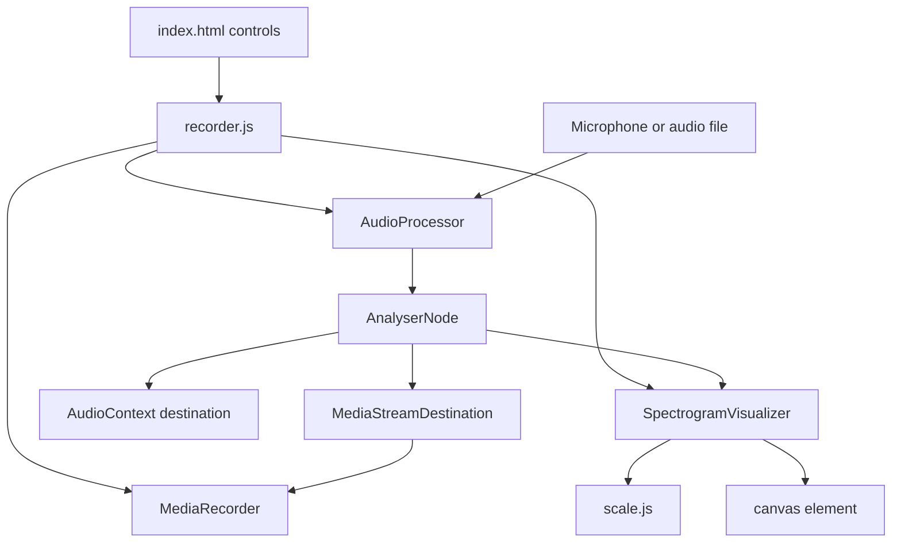

# Real-time Audio Spectrogram Analyzer - Architecture

## Overview

The Audio Spectrogram Analyzer captures audio from a microphone or a local file, routes it through the Web Audio API, and draws a scrolling time-frequency heatmap on a canvas. The visualizer features calibrated Y-axis frequency ticks (with an optional logarithmic scale toggle), time markers on the scrolling canvas, and a dynamic real-time dBFS colorbar. The same processed signal can be recorded locally and downloaded as a WebM file.

The application is a static collection of ES modules. It has no build step and no backend; microphone capture and recording happen entirely in the browser.

## Purpose & Goals

- Demonstrate real-time audio analysis with `AnalyserNode` and `getByteFrequencyData`.
- Provide an educational and practical acoustic inspection tool for sound analysis with calibrated physical axes.
- Support both linear and logarithmic frequency scales for inspecting musical notes, human speech formants, and high-frequency harmonics.
- Display a dynamic dBFS colorbar with real-time signal peak indicators.
- Render a readable spectrogram at animation speed without allocating a full history buffer every frame.
- Support both live microphone input and local audio files.
- Record the exact signal being visualized through a `MediaStreamDestination`.
- Fail gracefully when the microphone is unavailable or permission is denied.

## Folder Structure

```text
audio-spectrogram-analyzer/
|--  index.html          # Controls, canvas, scale toggle, error banner, and recording buttons
|--  style.css           # Responsive layout, dark/light theme, colormap legend
|--  scale.js            # Linear/logarithmic frequency scales, Y-to-frequency conversions, and dBFS math
|--  audio-processor.js  # AudioContext, source routing, analyser, decibel getters, and stream cleanup
|--  visualizer.js       # Scrolling heatmap, calibrated axes overlay, and dynamic dBFS colorbar
|--  recorder.js         # MediaRecorder integration and application bootstrap
|--  ARCHITECTURE.md     # This document
`--  thumbnail.svg       # Preview thumbnail used by the project registry
```

## System / Project Architecture Overview

The application is split into specialized modules with clear responsibilities. `AudioProcessor` owns the Web Audio graph, `scale.js` provides pure mathematical frequency and decibel mappings, `SpectrogramVisualizer` owns the canvas rendering and overlay axes, and `recorder.js` wires DOM controls and `MediaRecorder`.



The analyser is connected to both the speaker destination and a `MediaStreamDestination`, so the visualization and the recording see the same samples. The visualizer queries the processor for the latest frequency array, scales it according to the active scale mode (Linear or Logarithmic), and overlays calibrated axes.

## Component Breakdown

| Component               | Responsibility                                                                                                                                                       |
| ----------------------- | -------------------------------------------------------------------------------------------------------------------------------------------------------------------- |
| `scale.js`              | Pure mathematical conversions for Linear/Logarithmic frequency scales, Y-to-frequency mappings, dBFS conversions, and tick generation.                              |
| `AudioProcessor`        | Creates the `AudioContext`, obtains a microphone stream or an `<audio>` element source, wires the analyser, exposes decibel/sample rate metrics, and manages lifecycle. |
| `SpectrogramVisualizer` | Manages canvas dimensions, offscreen scrolling buffers, Magma colormap, time markers, calibrated frequency axes, and the dynamic dBFS colorbar.                    |
| `recorder.js`           | Binds controls (including scale toggle and FFT size), manages `MediaRecorder`, creates the download blob, and tears down audio resources on unload.                |
| `index.html`            | Provides microphone, file, record, stop, FFT size, and Scale controls plus the canvas, dBFS legend, and error banner.                                              |
| `style.css`             | Defines the responsive layout, theme palette, and calibrated legend.                                                                                                |

## Data Flow / Execution Flow

1. `DOMContentLoaded` creates one `AudioProcessor` and one `SpectrogramVisualizer`, then binds the controls including the frequency scale selector.
2. A microphone request calls `startMicrophone()`, which lazily creates the `AudioContext`, resumes it if suspended, and awaits `getUserMedia`.
3. The resulting `MediaStream` becomes a `MediaStreamAudioSourceNode`, which is connected to a new `AnalyserNode`.
4. A file request calls `loadAudioFile()`, which stops the previous source, creates an `<audio>` element with an object URL, and wraps it with `createMediaElementSource`.
5. `setupAnalyser()` sets the FFT size and smoothing, then connects the source to the analyser, the speakers, and the recording destination.
6. The visualizer loop calls `getFrequencyData()` on every frame. The analyser fills a cached `Uint8Array` with values from 0 to 255.
7. The visualizer scrolls its offscreen heatmap canvas by 2 pixels, maps frequency bins across rows via `yToFrequency()` (supporting Linear and Logarithmic distributions), and updates scrolling time markers.
8. The visualizer composites the scrolling heatmap onto the display canvas and overlays:
   - Calibrated Y-axis frequency ticks (e.g. 100 Hz, 1 kHz, 5 kHz, 10 kHz, 20 kHz) with horizontal gridlines.
   - Time markers and gridlines showing elapsed seconds across the scrolling canvas.
   - A dynamic dBFS colorbar with a live peak level needle and digital readout.
9. Recording creates a `MediaRecorder` around the destination stream. On stop, the chunks are combined into a Blob and downloaded.
10. On unload or an explicit destroy, the processor stops microphone tracks, revokes object URLs, pauses and clears the audio element, disconnects nodes, and closes the audio context; the visualizer cancels its animation frame and removes its resize listener.

## Key Features

- **Live microphone input** - Requests audio permission and reports a visible error if access is denied.
- **Local file input** - Loads an audio file, loops it, and analyzes it through the same graph.
- **Calibrated Frequency Y-Axis** - Displays exact physical frequency ticks (100 Hz to 20 kHz) with subtle dotted gridlines.
- **Linear & Logarithmic Frequency Scale Toggle** - Toggle between linear frequency spacing and logarithmic octave-based distribution for detailed acoustic inspection of musical pitch and speech formants.
- **Scrolling Time Markers** - Visual time markers (e.g., `0s`, `-1s`, `-2s`, `-3s`) scroll in lockstep with the spectrogram to provide accurate temporal duration analysis.
- **Dynamic dBFS Colorbar** - Right-hand calibrated decibel bar with a live peak indicator needle and real-time numerical dBFS level readout.
- **Scrolling spectrogram** - A 2-pixel column per frame produces a stable time axis without storing the full history.
- **Magma-style colormap** - A precomputed 256-entry RGBA table avoids per-pixel interpolation during the render loop.
- **Adjustable FFT size** - The analyser can switch between the supported FFT sizes at runtime.
- **Local recording** - Records the analyzed signal to WebM and downloads it on stop.
- **Theme support** - The page and legend follow the Cradle light and dark tokens.
- **Cleanup on unload and stop** - Stops tracks, revokes object URLs, cancels animation frames, and closes audio contexts when stopped or when the page is closed.

## Technologies Used

- Web Audio API: `AudioContext`, `AnalyserNode`, `MediaStreamAudioSourceNode`, `MediaElementAudioSourceNode`, `MediaStreamDestination`.
- Media Capture and Streams API: `getUserMedia`.
- MediaRecorder API with `audio/webm` feature detection.
- HTML5 Canvas 2D API with `drawImage`, `createLinearGradient`, and `putImageData`.
- `requestAnimationFrame` for the render loop.
- Vanilla ES6+ JavaScript modules.

## File Responsibilities

### `index.html`

- Declares the microphone, file, record, and stop buttons plus FFT size and frequency scale selectors.
- Hosts the spectrogram canvas, the amplitude legend, and the hidden error banner.
- Loads modules in dependency order.

### `scale.js`

- **`frequencyToY(freq, nyquist, height, isLogarithmic, minFreq)`** - maps physical frequency in Hz to canvas pixel Y.
- **`yToFrequency(y, nyquist, height, isLogarithmic, minFreq)`** - maps canvas pixel Y back to physical frequency in Hz.
- **`getFrequencyTicks(nyquist, isLogarithmic, minFreq)`** - generates calibrated tick points and human-readable labels.
- **`byteToDecibels(byteVal, minDecibels, maxDecibels)`** - converts raw byte amplitude to dBFS.
- **`decibelsToByte(dB, minDecibels, maxDecibels)`** - converts dBFS amplitude to 0-255 byte value.
- **`getDecibelTicks(minDecibels, maxDecibels, step)`** - produces decibel tick intervals.
- **`formatFrequency(freq)`** - formats frequency numbers into clean Hz or kHz strings.

### `audio-processor.js`

- **`init()`** - creates the `AudioContext` and the recording destination.
- **`startMicrophone()`** - acquires a stream, stops any existing source, builds the source node, and configures the analyser.
- **`loadAudioFile()`** - stops the previous source, creates an audio element with an object URL, and connects it to the graph.
- **`setupAnalyser()`** - sets `fftSize` and smoothing and connects the analyser to speakers and recording.
- **`setFFTSize()`** - applies a new FFT size to the existing analyser and invalidates cached frequency data.
- **`getFrequencyData()`** - returns the cached byte frequency array, or an empty array when no analyser exists.
- **`getSampleRate()` / `getMinDecibels()` / `getMaxDecibels()` / `getPeakDecibels()`** - exposes real-time acoustic calibration parameters.
- **`getRecordingStream()`** - exposes the destination stream for `MediaRecorder`.
- **`stop()`** - stops microphone tracks, pauses and clears the audio element, revokes the object URL, and disconnects source and analyser nodes.
- **`destroy()`** - calls `stop()` and closes the audio context.

### `visualizer.js`

- **`resizeCanvas()`** - sizes the backing store and offscreen buffers based on parent element dimensions and layout margins.
- **`setScale(scale)`** - switches between Linear and Logarithmic frequency mapping and clears buffers for smooth transition.
- **`generateMagmaColormap()`** - interpolates the Magma color stops into a 256-entry lookup table.
- **`drawFrequencyAxis()`** - renders calibrated frequency ticks, labels, and horizontal gridlines.
- **`drawTimeAxis()`** - renders scrolling time tick markers and elapsed time labels.
- **`drawDecibelColorbar()`** - renders the calibrated dBFS colorbar with live peak indicator needle and numerical readout.
- **`draw(audioProcessor)`** - shifts heatmap, maps frequency rows to pixels, and composites axes and meters.
- **`start()` / `stop()` / `destroy()`** - manages the `requestAnimationFrame` lifecycle.

### `recorder.js`

- Creates the processor and visualizer and wires every control including frequency scale.
- Starts and stops `MediaRecorder`, chooses a supported MIME type, and downloads the result.
- Calls `destroy()` on the visualizer and processor on `beforeunload` and `unload`.

### `style.css`

- Provides the responsive control layout and canvas frame.
- Defines the light and dark surfaces, text colors, and legend gradient.
- Keeps the canvas at a stable aspect ratio so frequency and time axes remain readable.

### `thumbnail.svg`

- Static preview artwork for the project registry and not part of the application.

## Design Decisions

- **Dedicated Offscreen Heatmap Canvas**: Maintaining the scrolling waterfall on an offscreen canvas and compositing it onto the display canvas prevents axes, gridlines, and text labels from smearing during horizontal scrolling.
- **Analytical Frequency Inversion**: `yToFrequency()` allows row-by-row sampling in logarithmic mode, ensuring low-frequency vowel formants and musical fundamentals occupy a prominent, readable portion of the vertical axis.
- **Precomputed Colormap**: A `Uint8ClampedArray` with 256 RGBA entries makes the per-bin color lookup constant time and avoids gradient math in the hot loop.
- **Dynamic dBFS Needle & Readout**: Live peak tracking with exponential decay smoothing gives users instantaneous acoustic level awareness alongside the spectral distribution.
- **Recording from a Destination Stream**: `MediaStreamDestination` captures the processed signal rather than relying on a second microphone permission.

## Dependencies

| Dependency              | Version          | How loaded    | Purpose                                   |
| ----------------------- | ---------------- | ------------- | ----------------------------------------- |
| Browser runtime         | Modern evergreen | Native        | Web Audio, MediaRecorder, canvas, modules |
| Cradle project registry | n/a              | Local tooling | Discovers the project and thumbnail       |

The project has no npm packages, CDN scripts, fonts, or external assets. A secure context (`https` or `localhost`) is required for microphone access in most browsers.

## Future Improvements

- Add a gain slider and a frequency range selector.
- Export the spectrogram itself as a PNG in addition to the audio recording.
- Use an `OffscreenCanvas` worker for very large FFT sizes.
- Add a pause control that freezes the heatmap without stopping audio.
- Support drag-and-drop for audio files.

## Known Limitations

- Microphone permission prompts and device selection are delegated entirely to the browser.
- Recording format support varies by browser; Safari may produce a different container than WebM.
- The application does not persist user settings such as FFT size or theme.
- There is no file size or duration limit for loaded audio.

## Development Notes

- Serve the folder over `localhost` or HTTPS. `getUserMedia` is blocked on insecure origins and on most `file://` URLs.
- The analyser FFT size must be a power of two between 32 and 32768. Keep the select options within that range.
- The recording destination is created once per `AudioContext`; recreate the context only when necessary.
- Call `audioProcessor.stop()` and `visualizer.stop()` together. Stopping only the animation leaves microphone tracks active.
- The colormap assumes 256 input levels.
- Run `npm run validate:architecture` from the repository root after editing this file.

## License & Attribution

- **Project License:** MIT, inherited from the Cradle repository.
- **Third-Party Assets:** None. The Magma-inspired colormap is implemented locally.

## References

- [MDN: Web Audio API](https://developer.mozilla.org/en-US/docs/Web/Audio_API)
- [MDN: AnalyserNode](https://developer.mozilla.org/en-US/docs/Web/API/AnalyserNode)
- [MDN: MediaRecorder API](https://developer.mozilla.org/en-US/docs/Web/API/MediaRecorder_API)
- [MDN: getUserMedia](https://developer.mozilla.org/en-US/docs/Web/API/MediaDevices/getUserMedia)
- [Cradle contribution guide](../../../CONTRIBUTING.md)
