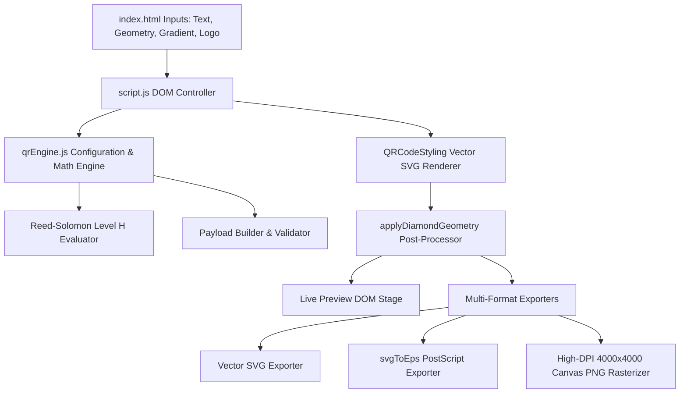

# Project Architecture — Advanced QR Code Generator

---

## Overview

Advanced QR Code Generator is a web application for creating, customizing, previewing, and downloading production-ready QR codes in real time. It features custom dot geometry styles (rounded dots, connected squircle modules, diamonds, classy curves), custom linear/radial gradient fills, adjustable corner eye shapes, and center vector/raster logo embedding with automatic Reed-Solomon error correction elevation (Level H — up to 30% damage recovery). It delivers multi-format export across vector SVG, print-ready Encapsulated PostScript (EPS), and ultra-high-DPI raster PNG (up to 4000×4000 px).

---

## Purpose & Goals

- Provide designers, developers, and marketers with a zero-dependency in-browser QR code builder capable of generating print-ready assets for physical packaging, apparel, and signage.
- Support customizable dot geometry styles: circular dots, connected squircles, diamonds, classy curves, and classic squares.
- Provide custom gradient fills (linear and radial with full $360^\circ$ rotation controls) and adjustable corner eye contours.
- Implement center logo/image embedding with automatic Reed-Solomon Level H elevation to guarantee 100% scan reliability even with central occlusion.
- Provide multi-format export for vector SVG, Encapsulated PostScript (EPS Level 2/3), and high-DPI raster PNG up to 4000×4000 px (300 DPI print quality).
- Modularize logic into a standalone UMD `qrEngine.js` for robust testability and node integration.

---

## Folder Structure

```text
advanced-qr-code-generator/
├── index.html          # Controls layout, geometry & gradient pickers, preview container, export buttons
├── qrEngine.js         # Payload generator, gradient builder, diamond geometry, SVG-to-EPS compiler, preset storage
├── script.js           # DOM bindings, live SVG preview rendering, high-DPI PNG rasterizer, download dispatcher
├── style.css           # Modern dark/light styling rules, elevation badges, responsive button grid
├── thumbnail.svg       # Card preview asset
└── ARCHITECTURE.md     # Architecture documentation
```

---

## System / Project Architecture Overview



---

## Component Breakdown

| File          | Responsibility                                                                                         |
| ------------- | ------------------------------------------------------------------------------------------------------ |
| `index.html`  | Accessible controls for content, colors, gradients, geometry, corner eyes, logo upload, and resolution |
| `qrEngine.js` | Option sanitation, automatic Level H elevation, gradient configuration, diamond geometry, SVG-to-EPS  |
| `script.js`   | DOM event listeners, live SVG generation, offscreen canvas 4000px rasterizer, multi-format export       |
| `style.css`   | Theme variables, gradient control panels, auto-elevation notification badge, responsive layout        |

---

## Data Flow / Execution Flow

```text
User enters text/URL or customizes geometry / colors / gradients / logo
↓
script.js receives event and checks if logo is uploaded
↓
When logo is present, error correction automatically elevates to Level H (30%)
↓
QREngine.buildConfigPayload() validates options, resolves gradients, and formats dots/corners
↓
QRCodeStyling generates scalable vector SVG markup in #qr-code-container
↓
If dotStyle is 'diamond', QREngine.applyDiamondGeometry() transforms circles to vector polygons
↓
Live preview displays crisp vector QR code in real time
↓
User clicks Export (PNG, SVG, or EPS):
  • PNG: renderSvgToBlob() rasterizes SVG onto offscreen canvas up to 4000×4000 px at 300 DPI
  • SVG: Packages standalone XML vector with <?xml ...> header
  • EPS: QREngine.svgToEps() compiles vector paths into standard PostScript EPSF-3.0
↓
triggerDownload() dispatches browser file download with sanitized filename
```

---

## Key Features

- **Custom Dot Geometry Styles**:
  - Rounded Dots (`dots`)
  - Connected Squircle Modules (`extra-rounded`)
  - Diamonds (`diamond`) via vector polygon transformation
  - Classy Curves (`classy` and `classy-rounded`)
  - Rounded Rectangles (`rounded`)
  - Classic Squares (`square`)
- **Custom Gradient Fills**:
  - Linear and Radial module gradient fills with customizable start and end colors
  - $0^\circ$ to $360^\circ$ gradient rotation angle control
- **Adjustable Corner Eye Shapes**:
  - Outer Corner Square: Squircle, Circular, or Square
  - Inner Corner Dot: Circular or Square
- **Center Logo/Image Embedding**:
  - Embed PNG, JPG, JPEG, and SVG logos with file signature validation
  - Adjustable logo scale percentage ($15\%$ to $35\%$)
  - **Automatic Reed-Solomon Level H Elevation**: Automatically promotes error correction to Level H (30% recovery) upon logo upload to protect data integrity from center occlusion
- **Multi-Format Export Suite**:
  - **Vector SVG**: Infinitely scalable vector export
  - **Encapsulated PostScript (EPS)**: Native PostScript Level 2/3 EPSF-3.0 export for print houses and Adobe Illustrator
  - **High-DPI Raster PNG**: Offscreen canvas rasterization supporting up to 4000×4000 px (300 DPI print-ready quality)

---

## Technologies Used

| Technology                | Purpose                                                                |
| ------------------------- | ---------------------------------------------------------------------- |
| HTML5                     | Form controls, file input, canvas, semantic layout                     |
| CSS3                      | Design tokens, dark/light themes, elevation badges, responsive grids   |
| Vanilla JavaScript (ES6+) | UMD engine module, SVG parsing, EPS compilation, DOM event handling    |
| PostScript (EPSF-3.0)     | Vector print specification output format                               |
| QRCodeStyling CDN         | Base QR matrix generation and mathematical placement                   |

---

## File Responsibilities

### `index.html`

- Form layout for content, colors, gradient controls, dot geometry selectors, corner eye styles, logo upload, and export resolution.
- Live preview canvas stage and status toast container.

### `qrEngine.js`

- `sanitizeOptions(inputOpts)`: Validates input, color hex codes, dimensions, and enforces automatic Level H elevation when a logo is present.
- `buildConfigPayload(opts)`: Maps state options into QRCodeStyling configuration payloads including linear/radial gradient definitions.
- `applyDiamondGeometry(svgString)`: Replaces circular dot elements with diamond vector `<polygon>` coordinates.
- `svgToEps(svgString)`: Translates SVG elements (`<rect>`, `<circle>`, `<polygon>`, `<path>`) into PostScript EPSF-3.0 operators.
- `getDownloadFilename(name, extension)`: Sanitizes filenames with support for `.png`, `.svg`, and `.eps`.
- `triggerDownload(blobOrUrl, filename, doc)`: Dispatches client-side download with explicit filename attributes.

### `script.js`

- Event listeners for live input, color pickers, gradient sliders, geometry dropdowns, and file upload.
- State management tracking previous user error correction level for automatic restoration when logos are removed.
- `renderSvgToBlob(svgSource, size, extension)`: Renders SVG markup to an offscreen HTML5 canvas up to 4000×4000 px.
- `downloadQR(extension)`: Handles export for PNG, SVG, and EPS.

### `style.css`

- Theme styling, elevation badge visuals, dashed gradient container rules, and responsive button grid.

---

## Design Decisions

- **Automatic Reed-Solomon Elevation**: Embedding logos necessarily destroys up to 25–30% of central QR modules. Automating the switch to Level H eliminates user error and prevents unreadable QR codes from going to print.
- **Pure JavaScript SVG-to-EPS Compiler**: Rather than requiring heavy external WASM or backend converters, `qrEngine.js` parses the vector elements and writes compliant PostScript text commands, keeping the client 100% standalone and zero-dependency.
- **Offscreen Canvas Scaling**: Rasterizing SVG at target dimensions (up to 4000×4000 px) ensures crisp, artifact-free high-DPI output suitable for large-format physical printing.

---

## Dependencies

- `qr-code-styling` (v1.6.0-rc.1 via CDN): Generates underlying QR matrix data and base SVG modules.
- Standard Web APIs (`Blob`, `URL`, `HTMLCanvasElement`, `XMLSerializer`, `FileReader`).

---

## Future Improvements

- CMYK color profile conversion directly in the EPS exporter for offset printing presses.
- Built-in library of common vector brand icons (WiFi, GitHub, LinkedIn, Instagram, URL icons).

---

## Known Limitations

- High error correction levels (H) increase the QR module density, which requires a minimum physical print size of roughly $2 \times 2\text{ cm}$ for reliable camera scanning.

---

## Development Notes

- Unit test suite run via `node --test tests/advanced-qr-code-generator.test.js`.
- EPS output conforms to the Adobe Encapsulated PostScript File Format Specification Version 3.0.

---

## License & Attribution

- **Project License:** MIT
- **Third-Party Assets:** FontAwesome 6 (icons), Google Fonts (Poppins, Inter).

---

## References

- [Adobe PostScript Language Reference (3rd Edition)](https://www.adobe.com/products/postscript/pdfs/PLRM.pdf)
- [W3C Scalable Vector Graphics (SVG) 1.1 Specification](https://www.w3.org/TR/SVG11/)
- [ISO/IEC 18004:2015 — QR Code bar code symbology specification](https://www.iso.org/standard/62021.html)
