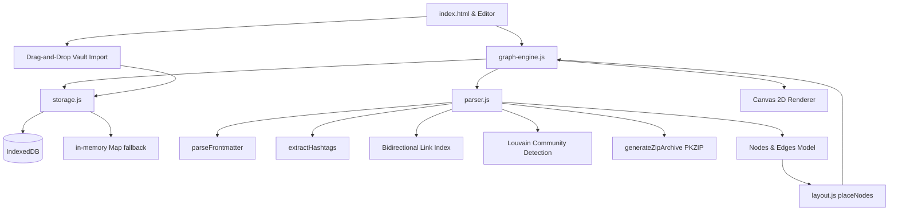

# Local-First Markdown Knowledge Graph - Architecture

## Overview

The Local-First Markdown Knowledge Graph is a personal knowledge management (PKM) note editor and graph visualization workspace that turns Obsidian-compatible `[[wikilinks]]` and `#hashtags` into an interactive, clustered force-directed graph. Notes are stored locally in IndexedDB with an in-memory `Map` fallback. The application features mathematical community detection via the Louvain modularity algorithm, full-text search with smooth cubic-eased camera focal centering, bidirectional backlink indexing with an interactive inspector, and local Markdown note vault drag-and-drop import and PKZIP vault export with full YAML frontmatter preservation.

The project is a static web application built with vanilla ES modules, Canvas 2D, and standard Web APIs with zero external dependencies.

## Purpose & Goals

- Provide an Obsidian-compatible personal knowledge management (PKM) second-brain utility that operates entirely in the browser.
- Parse rich wikilinks (`[[Target]]`, `[[Target|Alias]]`, `[[Target#Section]]`, `[[Target#Section|Alias]]`) and extract bidirectional backlinks and outgoing links.
- Parse YAML frontmatter and inline `#hashtags` to categorize notes and support granular tag filtering.
- Apply the Louvain modularity algorithm to discover natural topic clusters and color-code communities with an accessible palette.
- Provide responsive full-text search across titles, markdown content, and tags with visual dimming and smooth camera centering.
- Support drag-and-drop import and export of Markdown vaults as standard PKZIP archives with YAML frontmatter preservation.
- Maintain a dependency-free, modular architecture separating storage, parsing, graph algorithms, layout mathematics, and rendering.

## Folder Structure

```text
knowledge-graph/
|--  index.html          # Split-pane editor, note inspector, search bar, and canvas workspace
|--  style.css           # Responsive layout, theme colors, inspector chips, and drop overlay
|--  storage.js          # IndexedDB wrapper with an in-memory fallback
|--  parser.js           # Wikilink, hashtag, YAML frontmatter parsing, Louvain modularity, and PKZIP generator
|--  layout.js           # Position preservation, centered viewport, and arrowhead geometry
|--  graph-engine.js     # Force simulation, Canvas 2D renderer, search, camera animation, and UI bootstrap
|--  ARCHITECTURE.md     # This document
`--  thumbnail.svg       # Preview thumbnail used by the project registry
```

## System / Project Architecture Overview

The data flow is modular and reactive: notes stored in IndexedDB (or the in-memory fallback) are loaded into `GraphParser`. The parser extracts YAML frontmatter, hashtags, and Obsidian-compatible wikilinks, indexes bidirectional links (`outlinks` and `backlinks`), and computes community clusters using the Louvain algorithm. The layout engine preserves existing coordinates, velocities, and pinned states, and `GraphEngine` drives the physics simulation, full-text search filtering, camera focal centering, and Canvas 2D rendering.



## Component Breakdown

| Component        | Responsibility                                                                                                                                                                                                |
| ---------------- | ------------------------------------------------------------------------------------------------------------------------------------------------------------------------------------------------------------- |
| `StorageManager` | Opens IndexedDB, manages the `notes` object store, and exposes unified async CRUD methods (`saveNote`, `getAllNotes`, `getNote`, `deleteNote`) with an in-memory fallback.                                   |
| `GraphParser`    | Parses Obsidian-compatible wikilinks with alias and header support, extracts YAML frontmatter, identifies inline hashtags, maintains bidirectional backlink indices, and runs Louvain community detection.    |
| `parser.js` helpers | Provides `parseFrontmatter`, `formatFrontmatter`, `extractHashtags`, `detectCommunities`, `crc32`, `generateZipArchive`, `exportNoteMarkdown`, and `createVaultZip`.                                        |
| `layout.js`      | Provides `placeNodes` to preserve positions, velocities, and pin states across reloads, `getCenteredTransform` for viewport calculations, and `computeArrowhead` for edge geometry.                           |
| `GraphEngine`    | Manages the canvas physics loop, Louvain cluster coloring, full-text search with node dimming, smooth camera focal centering, interactive note inspection, drag-and-drop vault import, and PKZIP vault export. |
| `index.html`     | Provides the split-pane layout with search bar, cluster toggle, note title/body editor, Backlinks & Tags inspector, note list with badges, and canvas drop zone.                                            |
| `style.css`      | Styles the responsive interface, tag chips, backlink buttons, search bar, cluster toggle active states, drop zone overlay, and dark/light color schemes.                                                      |

## Data Flow / Execution Flow

1. **Storage Initialization**: On page load, `StorageManager` connects to IndexedDB `CradleKnowledgeGraphDB`. If IndexedDB is blocked or in private browsing mode, it transparently routes operations to an in-memory `Map`.
2. **Data Loading & Parsing**: `GraphEngine.loadData()` reads notes from storage. If empty on first launch in the browser, it seeds starter notes demonstrating Obsidian links, hashtags, and community clusters.
3. **Graph Construction & Bidirectional Indexing**: `GraphParser.parse()` processes each note:
   - Parses YAML frontmatter (`parseFrontmatter`) to extract metadata (`title`, `tags`, `aliases`).
   - Extracts inline hashtags (`extractHashtags`) and merges them with frontmatter tags.
   - Extracts Obsidian-style links (`[[Target]]`, `[[Target|Alias]]`, `[[Target#Section]]`, `[[Target#Section|Alias]]`).
   - Populates `outlinks` on the source node and `backlinks` on target nodes (creating placeholder nodes for unauthored targets).
4. **Community Detection**: `detectCommunities()` executes the Louvain modularity algorithm on the undirected graph adjacency matrix. Modularity gain $\Delta Q = k_{i,\text{in}} - \frac{\Sigma_{\text{tot}} \cdot k_i}{2m}$ is optimized to assign `clusterId` and `clusterColor`.
5. **Layout Stabilization**: `placeNodes()` maps existing nodes by ID to retain coordinates, velocities, and pinned states (`fx`, `fy`), assigning bounded random coordinates only to newly created nodes.
6. **Physics & Rendering**: The `requestAnimationFrame` loop executes `applyForces()` (node repulsion, edge springs, center gravity, and velocity damping) and `render()`. Nodes are drawn with their cluster color (or theme default), search matches and focused nodes receive illuminated halo rings, non-matching nodes are dimmed, and directed edges display precise arrowheads.
7. **Inspection & Camera Centering**: Clicking a note or node updates `#note-inspector` with clickable backlink and outgoing link chips, and smooth camera focal centering (`focusNode()`) animates the viewport using cubic easing (`easeInOutCubic`) over 400ms.
8. **Vault Import & Export**: Dropping Markdown files or selecting them via the file picker parses YAML frontmatter and imports them into storage. The "Export Vault" button packages all notes into an Obsidian-compatible `.zip` archive generated via pure-JS PKZIP 2.0.

## Key Features

- **Obsidian-Compatible Wikilinks**: Full support for `[[Note Name]]`, `[[Note Name|Alias]]`, `[[Note Name#Header]]`, and `[[Note Name#Header|Alias]]`.
- **Bidirectional Backlink Indexing**: Maintains real-time incoming (`backlinks`) and outgoing (`outlinks`) link references for every note with an interactive inspector.
- **Automatic Hashtag & YAML Frontmatter Extraction**: Detects `#tag` and `#nested/tag` patterns alongside standard YAML frontmatter blocks (`tags: [pkm, graph]`), keeping metadata preserved during round-trip editing.
- **Louvain Community Detection**: Discovers latent topic clusters using network modularity optimization, dynamically applying curated high-contrast palette colors with an ON/OFF toggle.
- **Full-Text Search with Query Highlighting**: Real-time filtering searches titles, bodies, and `#tags`, highlighting matching nodes and dimming non-matching elements.
- **Smooth Camera Focal Centering**: Smooth cubic-eased camera animation centers and zooms onto any focused or searched note.
- **Drag-and-Drop Vault Import**: Seamlessly drag and drop local Markdown files or vaults directly into the workspace with instant parsing and graph regeneration.
- **Pure-JS PKZIP Vault Export**: In-browser zero-dependency ZIP archive generator creates standard Obsidian-compatible vault archives (`.zip`) and single-note Markdown files (`.md`).
- **Directed Arrowheads & Node Pinning**: Directed edge arrows terminate accurately at node boundaries, and double-click or right-click pins nodes in place with amber halo rings.
- **Local-First Resilience**: Automatic persistence in IndexedDB with seamless in-memory fallback.

## Technologies Used

- **HTML5 Canvas 2D API**: High-performance rendering of nodes, directed arrows, halos, and text labels.
- **IndexedDB API**: Client-side structured storage with in-memory `Map` fallback.
- **Vanilla ES6+ Modules**: Clean modular separation of concerns with zero build-step or bundler requirements.
- **Louvain Modularity Algorithm**: Graph partitioning heuristic optimizing network modularity $Q$.
- **Pure JavaScript PKZIP 2.0**: RFC 1951 / PKZIP 2.0 stored format implementation with 32-bit CRC checksum generation.
- **CSS Grid & Flexbox**: Responsive split-pane layout adapting smoothly to desktop and mobile viewports.

## File Responsibilities

### `index.html`

- Declares the split-pane layout with the note editor, note inspector, vault note list, and graph canvas.
- Provides accessible controls: Save, Delete, Export .md, Import .md, Export Vault (.zip), Search bar, Cluster toggle, and Reset View.
- Houses the drag-and-drop drop zone overlay.
- Loads `layout.js`, `parser.js`, `storage.js`, and `graph-engine.js` as ES modules.

### `storage.js`

- **`StorageManager`**: Wraps IndexedDB operations (`saveNote`, `getAllNotes`, `getNote`, `deleteNote`) with Promise-based APIs.
- Maintains `memoryStore` as an in-memory fallback when IndexedDB is unavailable.

### `parser.js`

- **`parseFrontmatter(text)`**: Extracts YAML frontmatter keys, arrays, and body content, preserving raw metadata.
- **`formatFrontmatter(frontmatter, body)`**: Re-serializes frontmatter and body into valid Markdown.
- **`extractHashtags(text)`**: Extracts inline hashtags and nested tags, filtering out numeric headings and hex colors.
- **`detectCommunities(nodes, edges)`**: Executes Louvain modularity clustering, assigning `clusterId` and `clusterColor`.
- **`crc32(data)`**: Computes standard IEEE 802.3 32-bit CRC checksums.
- **`generateZipArchive(files)`**: Builds zero-dependency PKZIP 2.0 binary archives.
- **`exportNoteMarkdown(note)`**: Formats a note ensuring YAML frontmatter preservation.
- **`createVaultZip(notes)`**: Generates an Obsidian-compatible vault ZIP archive for all notes.
- **`GraphParser.parse(notes)`**: Parses titles, wikilinks, hashtags, and frontmatter, and indexes bidirectional links.

### `layout.js`

- **`placeNodes(nodes, previousNodes)`**: Preserves existing coordinates, velocities, and pinned anchors (`pinned`, `fx`, `fy`), initializing new nodes with bounded coordinates.
- **`getCenteredTransform(width, height, k)`**: Calculates the viewport transform that places world origin `(0, 0)` at the canvas center.
- **`computeArrowhead(source, target, nodeRadius, arrowLength, arrowAngle)`**: Calculates geometric tip and wing endpoints for edge arrowheads.

### `graph-engine.js`

- **`GraphEngine`**: Coordinates physics simulation, rendering, interactions, search, and camera easing.
- **`loadData()`**: Loads notes from storage, runs `GraphParser.parse()`, preserves coordinates with `placeNodes()`, and updates the UI.
- **`searchNotes(query)`**: Searches notes and tags, updating the search result set and match count.
- **`focusNode(nodeId, targetZoom, duration)`**: Animates camera centering using `easeInOutCubic` interpolation.
- **`toggleClusterColors()`**: Switches between Louvain community cluster colors and theme default colors.
- **`selectNote(noteOrId, shouldFocusCamera)`**: Loads note into editor, inspects backlinks and tags, and centers camera.
- **`updateInspector(node, note)`**: Renders interactive backlinks, outgoing links, and tag chips.
- **`updateNoteList(notes)`**: Renders note items with cluster dots and backlink count badges.
- **`setupVaultImportExport()`**: Handles file input and drag-and-drop Markdown vault import, and triggers ZIP/MD downloads.
- **`applyForces()`**: Computes node-node repulsion, edge springs, damping, and center gravity, respecting pinned coordinates.
- **`render()`**: Draws edges, arrowheads, cluster-colored nodes, search halos, pin rings, and labels.

### `style.css`

- Styles the responsive two-pane flex layout with dark and light color scheme support.
- Defines styles for search inputs, cluster toggles, tag pills, backlink chips, and the drag-and-drop overlay.

### `thumbnail.svg`

- Static preview graphic representing the knowledge graph in the project registry.

## Design Decisions

- **Obsidian Compatibility**: Adopting standard Obsidian syntax (`[[wikilinks]]`, `#tags`, and YAML frontmatter) ensures users can directly import and export their existing personal knowledge vaults.
- **Bidirectional Link Indexing**: Indexing both `outlinks` and `backlinks` during parsing enables linked reference discovery without requiring a secondary database.
- **Louvain Modularity for Communities**: Louvain clustering is deterministic, scales linearly with edge count, and uncovers natural conceptual topics without requiring manual categorization.
- **Pure-JS PKZIP Generator**: Implementing standard PKZIP 2.0 (uncompressed stored method with CRC-32) allows instant vault export in the browser without third-party dependencies.
- **Smooth Cubic Camera Easing**: Animating camera focal shifts over 400ms with cubic easing prevents disorienting viewport jumps when navigating interconnected notes.
- **Position & Pin Preservation**: Reusing previous coordinates, velocities, and fixed anchors prevents chaotic layout resets during note updates.

## Dependencies

| Dependency              | Version          | How loaded    | Purpose                             |
| ----------------------- | ---------------- | ------------- | ----------------------------------- |
| Browser runtime         | Modern evergreen | Native        | Canvas 2D, IndexedDB, ES6+ modules  |
| Cradle project registry | n/a              | Local tooling | Discovers the project and thumbnail |

The project has no npm packages, external scripts, or CDN dependencies.

## Future Improvements

- Add graph filtering by cluster ID or minimum degree threshold.
- Support markdown rendering with live preview in the editor pane.
- Support graph edge weight customization based on link frequency or section context.
- Add local full-vault text regex replace for renaming notes across all wikilinks.

## Known Limitations

- Pure-JS PKZIP export creates uncompressed stored archives, which are standard and universally readable but larger than compressed archives.
- Very large vaults (>1,000 notes) may experience reduced physics frame rates on low-power devices.
- Renaming a note title in the editor does not automatically rewrite wikilinks pointing to the old title in other notes.

## Development Notes

- Serve the project via a local HTTP server (`npm run dev`) to enable ES module resolution.
- Open DevTools -> Application tab -> IndexedDB -> `CradleKnowledgeGraphDB` to inspect stored notes.
- Reset View button restores the viewport to center at zoom level 1.
- Run repository validation scripts (`node scripts/validate-architecture-docs.js`, `node scripts/validate-mini-projects.js`, `node scripts/validate-accessible-labels.js`, `node scripts/validate-no-dynamic-eval.js`) after modifying files.

## License & Attribution

- **Project License:** MIT, inherited from the Cradle repository.
- **Third-Party Assets:** None.

## References

- [Obsidian: Internal links and YAML frontmatter](https://help.obsidian.md/Linking+notes+and+files/Internal+links)
- [Blondel et al. Fast unfolding of communities in large networks (Louvain method)](https://arxiv.org/abs/0803.0476)
- [PKWARE .ZIP File Format Specification](https://pkware.cachefly.net/webdocs/casestudies/APPNOTE.TXT)
- [MDN: IndexedDB API](https://developer.mozilla.org/en-US/docs/Web/API/IndexedDB_API)
- [MDN: CanvasRenderingContext2D](https://developer.mozilla.org/en-US/docs/Web/API/CanvasRenderingContext2D)
- [Cradle contribution guide](../../../CONTRIBUTING.md)
