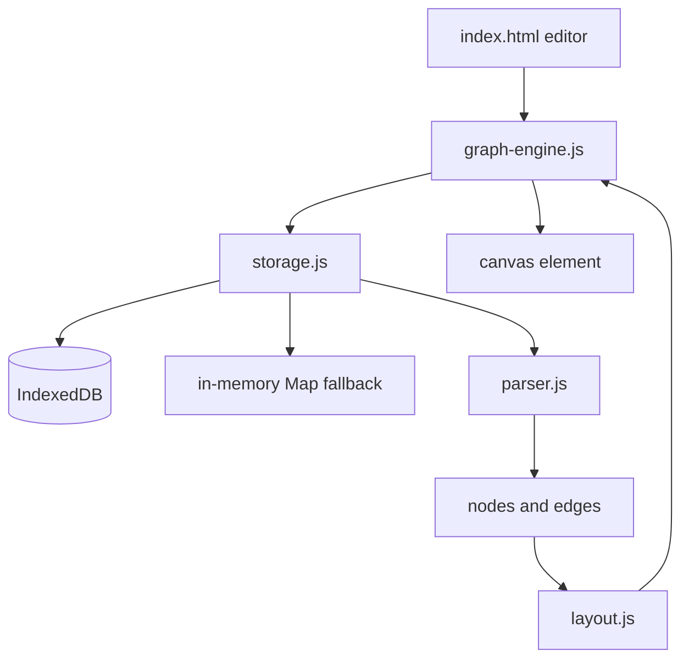

# Local-First Markdown Knowledge Graph - Architecture

## Overview

The Local-First Markdown Knowledge Graph is a note editor that turns `[[wikilinks]]` into an interactive force-directed graph. Notes are stored in IndexedDB when available, with an in-memory `Map` fallback for private browsing or blocked storage. The graph is drawn on a canvas by a small custom physics engine with pan, zoom, and node dragging.

The project is a static page with ES modules. It has no backend, no account model, and no external visualization library.

## Purpose & Goals

- Provide a frictionless way to connect notes without a server.
- Parse wiki-style links into a node and edge model that can be visualized immediately.
- Degrade to in-memory storage when IndexedDB is unavailable instead of failing to start.
- Demonstrate a dependency-free force simulation that remains readable.
- Keep editing, parsing, storage, and rendering in separate modules.

## Folder Structure

```text
knowledge-graph/
|--  index.html          # Split-pane editor and graph canvas
|--  style.css           # Responsive layout, theme colors, and panel styling
|--  storage.js          # IndexedDB wrapper with an in-memory fallback
|--  parser.js           # Wikilink extraction and graph construction
|--  layout.js           # Node position preservation and centered viewport helpers
|--  graph-engine.js     # Force simulation, canvas renderer, and UI bootstrap
|--  ARCHITECTURE.md     # This document
`--  thumbnail.svg       # Preview thumbnail used by the project registry
```

## System / Project Architecture Overview

The data path is linear: storage returns notes, the parser turns notes into nodes and edges, and the graph engine owns both the physics state and the canvas. The editor is a thin client over the same storage layer.



`GraphEngine` is the only module with a DOM dependency. `GraphParser` is stateless and static. `StorageManager` hides the difference between IndexedDB and the fallback behind one async API.

## Component Breakdown

| Component        | Responsibility                                                                                                              |
| ---------------- | --------------------------------------------------------------------------------------------------------------------------- |
| `StorageManager` | Opens the database, creates the object store, and exposes CRUD methods with a memory fallback.                              |
| `GraphParser`    | Builds node objects from note titles and edges from `[[wikilink]]` matches, including links to notes that do not exist yet. |
| `layout.js`      | Provides `placeNodes` to preserve node positions across reloads and `getCenteredTransform` for viewport centering.          |
| `GraphEngine`    | Loads notes, assigns positions, runs the force simulation, renders the canvas, and handles pan, zoom, and drag.             |
| `index.html`     | Provides the note list, title and content fields, save and delete controls, and the graph canvas.                           |
| `style.css`      | Defines the split-pane layout, responsive stacking, and light/dark palette.                                                 |

## Data Flow / Execution Flow

1. `StorageManager` is constructed and starts `init()` immediately. It opens `CradleKnowledgeGraphDB` and marks IndexedDB as available, or falls back to the in-memory map.
2. On `DOMContentLoaded`, `graph-engine.js` creates a `GraphEngine`, binds the editor controls, and calls `loadData()`.
3. `loadData()` reads notes from storage, passes them to `GraphParser.parse()`, and uses `placeNodes()` to retain positions and velocities of existing nodes while positioning only new nodes.
4. The canvas initializes with `getCenteredTransform()` to center world point `(0, 0)` in the viewport.
5. The animation loop calls `applyForces()` and `render()` on every frame.
6. When the canvas is resized, `resizeCanvas()` shifts the viewport transform by half of the delta, preserving the centered world point and current zoom.
7. Creating or saving a note persists it to storage and triggers `loadData()` to update the graph without resetting existing node positions.
8. Deleting a note removes it from storage, clears the form, and updates the graph and sidebar.

## Key Features

- **Wikilink extraction** - Discovers links in `[[Note Title]]` syntax and turns them into directed edges.
- **Local persistence** - Saves notes to IndexedDB so they survive page refreshes.
- **Memory fallback** - Transparently stores notes in memory when storage is disabled.
- **Position preservation** - Existing nodes keep their coordinates and velocities when the graph reloads.
- **Centered viewport** - Graph centers on initial load and stays centered across window resizes.
- **Interactive canvas** - Supports dragging nodes, panning the viewport, and zooming with the wheel.
- **Theme support** - Follows Cradle light and dark mode variables for surfaces, text, nodes, and edges.

## Technologies Used

- HTML5 Canvas 2D API for graph rendering.
- IndexedDB API with an in-memory `Map` fallback.
- Vanilla ES6+ JavaScript modules.
- CSS Grid and Flexbox for the split-pane layout.
- `requestAnimationFrame` for the physics tick.

## File Responsibilities

### `index.html`

- Declares the left pane with the note list and editor fields.
- Declares the right pane with the canvas and graph controls.
- Provides Save, New, Delete, and Reset View buttons.
- Loads `graph-engine.js` as a module.

### `storage.js`

- **`init()`** - detects IndexedDB and opens the database, falling back on failure.
- **`openDB()`** - creates the `notes` object store with `id` as the key path.
- **`saveNote()` / `getAllNotes()` / `getNote()` / `deleteNote()`** - route each operation to IndexedDB or the memory map.
- The fallback is intentionally complete, so callers do not need to branch on storage availability.

### `parser.js`

- **`GraphParser.parse(notes)`** - returns `{ nodes, edges }`.
- Deduplicates edges by source and target.
- Trims whitespace inside link brackets.
- Creates placeholder nodes for missing targets.
- Resets positions to zero; the engine decides where new nodes start.

### `layout.js`

- **`placeNodes(nodes, previousNodes)`** - matches nodes by id, copies position and velocity from existing nodes without treating `(0, 0)` as a sentinel, and positions genuinely new nodes.
- **`getCenteredTransform(width, height, k)`** - returns a viewport transform centered on the canvas.

### `graph-engine.js`

- **`GraphEngine`** - owns the canvas, transform, node arrays, and interaction state.
- **`loadData()`** - reads notes, parses the graph, and assigns/preserves positions via `placeNodes()`.
- **`resizeCanvas()`** - resizes canvas backing store and adjusts transform to preserve the centered world point.
- **`updateNoteList()`** - renders the sidebar and loads a note into the editor on click.
- **`setupInteractions()`** - handles pan, zoom, node drag, and selection.
- **`animate()`** - runs one physics step and one render pass per frame.
- **`render()`** - draws edges, nodes, labels, and the selected state.
- **Bootstrap** - creates the storage and engine objects and binds Save, New, Delete, and Reset View.

### `style.css`

- Provides the two-pane flex layout and the responsive stack for narrow screens.
- Styles the note list, form fields, buttons, and canvas frame.
- Defines the node, edge, label, and selection colors used by the renderer.

### `thumbnail.svg`

- Static preview artwork for the project registry and not part of the application.

## Design Decisions

- **Custom physics instead of D3**: Repulsion, springs, and damping are simple enough to implement directly, and avoiding a large dependency keeps the project inspectable.
- **Position preservation**: Reusing previous node positions and velocities prevents jarring layout jumps when saving or modifying notes.
- **Placeholder nodes**: Creating nodes for missing targets turns broken links into visible prompts rather than silently dropping them.
- **Storage abstraction**: The rest of the app calls the same async methods regardless of whether IndexedDB is available, which keeps private-browsing behavior graceful.
- **Canvas instead of SVG**: A canvas avoids creating a DOM node per element and keeps rendering predictable as the graph grows.
- **Debounced save**: Waiting after the last keystroke reduces write pressure while still persisting promptly.

## Dependencies

| Dependency              | Version          | How loaded    | Purpose                             |
| ----------------------- | ---------------- | ------------- | ----------------------------------- |
| Browser runtime         | Modern evergreen | Native        | Canvas 2D, IndexedDB, ES6+ modules  |
| Cradle project registry | n/a              | Local tooling | Discovers the project and thumbnail |

The project has no npm packages, external scripts, or CDN dependencies.

## Future Improvements

- Add directed arrowheads on link edges.
- Add tag parsing (`#tag`) and color-code nodes by tag.
- Support markdown rendering in note preview mode.
- Export and import notes as a zip archive of Markdown files.
- Add cluster-based layout initialization for dense graphs.

## Known Limitations

- Graph physics slows down on large graphs (>500 nodes).
- Wikilinks do not support custom alias text (e.g. `[[Target|Alias]]`).
- Notes are stored with simple titles; renaming a note does not update existing links pointing to it.

## Development Notes

- Serve the folder through a local HTTP server (`npm run dev`) so ES modules load properly.
- Open DevTools Application tab -> IndexedDB -> `CradleKnowledgeGraphDB` to inspect stored notes.
- Reset zoom returns the viewport to centered at zoom level 1.
- Run `npm run validate:architecture` from the repository root after editing this file.

## License & Attribution

- **Project License:** MIT, inherited from the Cradle repository.
- **Third-Party Assets:** None.

## References

- [MDN: IndexedDB API](https://developer.mozilla.org/en-US/docs/Web/API/IndexedDB_API)
- [MDN: CanvasRenderingContext2D](https://developer.mozilla.org/en-US/docs/Web/API/CanvasRenderingContext2D)
- [Cradle contribution guide](../../../CONTRIBUTING.md)
